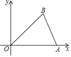

# Mathematics - 题目 3278

**ID**: fb82e8ee19754790ac1351018ec7ab9f
**年级**: Grade 8
**难度**: Easy
**题型**: Fill-in-the-blank

## 题目
如图，在平面直角坐标系xOy中，已知点A( $\sqrt {3}$ ，0)，B(1，1)．若平移点B到点D，使四边形OADB是平行四边形，则点D的坐标是．​​​​​​​‌

## 解答

1. 解：∵A( $\sqrt {3}$ ，0)，
2. ∴OA＝ $\sqrt {3}$ ，
3. ∵四边形OADB是平行四边形，
4. ∴BD＝OA＝ $\sqrt {3}$ ，BD∥OA，
5. ∵B(1，1)，
6. ∴D( $\sqrt {3}$ +1，1)，
7. 故答案为：( $\sqrt {3}$ +1，1)．

## 知识点

**中文**:
  - 坐标与图形变化——平移
  - 平行四边形的判定与性质

**English**:
  - Coordinates and Translation
  - Determination and Properties

---
