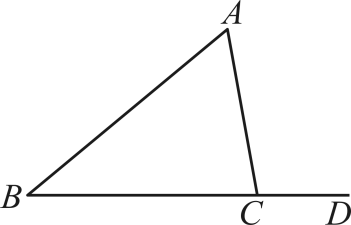

# Mathematics - 题目 1558

**ID**: 0b04bcfe43d4413e85e795dec256ee89
**年级**: Grade 8
**难度**: Easy
**题型**: Multiple-choice

## 题目
如图，在 $\vartriangle ABC$ 中，外角 $\angle ACD=100{}\degree $ ， $\angle B=40{}\degree $ ，则 $∠A$ 的度数为 （      ）​​​​​​​‌

## 解答

1. 解：∵ $\angle ACD=100{}\degree $ ，
2. ∴ $\angle A=\angle ACD-\angle B=100{}\degree -40{}\degree =60{}\degree $ ．
3. 故此题答案为C．

## 知识点

**中文**:
  - 三角形的外角性质

**English**:
  - Exterior Angle Properties

---
