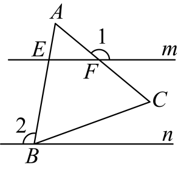

# Mathematics - 题目 1815

**ID**: 2faadd1085fd45d58baa70da95c16ca1
**年级**: Grade 8
**难度**: Easy
**题型**: Multiple-choice

## 题目
如图，直线 $m{\rm{/\mskip-4mu/}}n$ ， $\vartriangle ABC$ 是等边三角形，顶点 ${\rm \mathit{B}}$ 在直线 ${\rm \mathit{n}}$ 上，直线 ${\rm \mathit{m}}$ 交 $AB$ 于点 ${\rm \mathit{E}}$ ，交 $AC$ 于点 ${\rm \mathit{F}}$ ，若 $\angle 1=140{}^\circ $ ，则 $\angle 2$ 的度数是（      ）​​​​​​​‌

## 解答

1. 解：如下图所示：
2. $\because \vartriangle ABC$ 为等边三角形，
3. $\therefore \angle A=60{}^\circ $ ，
4. $\because \angle 1$ 是 $\mathrm{△}AEF$ 的一个外角， $\angle 1=140{}^\circ $ ，
5. $\therefore \angle 1=\angle A+\angle AEF$ ，
6. $\therefore \angle AEF=\angle 1-\angle A=140{}^\circ -\angle A=140{}^\circ -60{}^\circ =80{}^\circ $ ，
7. $\therefore \angle DEB=\angle AEF=80{}^\circ $ ，
8. $\because $ 直线 $m{\rm{/\mskip-4mu/}}n$ ，
9. $\therefore \angle DEB+\angle 2=180{}^\circ $ ，
10. $\therefore \angle 2=180{}^\circ -\angle DEB=180{}^\circ -80{}^\circ =100{}^\circ $ ．
11. 故此题答案为C

## 知识点

**中文**:
  - 三角形的外角性质
  - 两直线平行同旁内角互补
  - 等边三角形的性质

**English**:
  - Exterior Angle Properties
  - Parallel Lines have Supplementary Consecutive Angles
  - Properties of Equilateral Triangles

---
