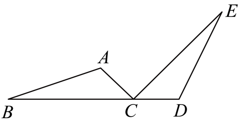

# Mathematics - 题目 2035

**ID**: 40167fc8d25742acbb73444715e8ac60
**年级**: Grade 8
**难度**: Easy
**题型**: Multiple-choice

## 题目
如图，点 $B$， $C$，$D$ 在同一直线上，若 $\mathrm{△}ABC≌\mathrm{△}DEC$ ， $AC=3$ ， $BD=10$ ，则 $CE$ 等于（      ）​​​​​​​‌

## 解答

1. ∵ $\mathrm{△}ABC≌\mathrm{△}DEC$ ，
2. ∴ $BC=EC$ ， $AC=CD=3$ ，
3. ∵ $BD=10$ ，
4. ∴ $BC=BD-CD=10-3=7$ ，
5. ∴ $CE=BC=7$ ．
6. 故选B．

## 知识点

**中文**:
  - 全等三角形的性质

**English**:
  - Properties of Congruent Triangles

---
