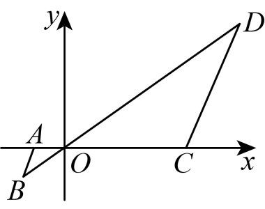

# Mathematics - 题目 3801

**ID**: 4864722928ef4206a7e1313c6b402871
**年级**: Grade 8
**难度**: Easy
**题型**: Multiple-choice

## 题目
如图，在平面直角坐标系中，将 $\vartriangle AOB$ 以原点O为位似中心放大，得到 $△COD$ ，若点A和点C的坐标分别为 $\left ({-1,0}\right )$ ， $\left ({4,0}\right )$ ，则 $\vartriangle AOB$ 与 $△COD$ 的面积之比为（      ）​​​​​​​‌

## 解答

1. 解： $\because A(-1,0)$ ， $C(4,0)$ ，
2. $\therefore OA=1$ ， $OC=4$ ．
3. $\because $ 将 $\vartriangle AOB$ 以原点 $O$ 为位似中心放大，得到 $△COD$ ，
4. $\therefore \vartriangle AOB$ 与 $△COD$ 的相似比是 $OA:OC=1:4$ ．
5. $\therefore \vartriangle AOB$ 与 $△COD$ 的面积比是 $1:16$ ．
6. 故选C．

## 知识点

**中文**:
  - 坐标系与位似图形

**English**:
  - Coordinates and Homothetic Figures

---
