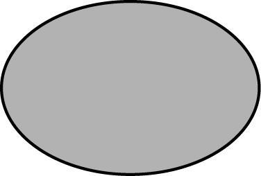

# Mathematics - 题目 1796

**ID**: 4a88aab0cdb94f49869bad8ccf18c049
**年级**: Grade 8
**难度**: Easy
**题型**: Multiple-choice

## 题目
美琪在做数学作业时，不小心将式子中除号后边的代数式污染，即 $(\frac{4-{x}^{2}}{3{x}^{2}-2xy})÷$，通过查看答案，得知结果为 $\frac{x+2}{3x-2y}$ ，则被污染的代数式为（      ）​​​​​​​‌

## 解答

1. 由题意得 $\frac{4-{x}^{2}}{3{x}^{2}-2xy}÷\frac{x+2}{3x-2y}=\frac{(2+x)(2-x)}{x(3x-2y)}\cdot \frac{3x-2y}{x+2}=\frac{2-x}{x}$ ， $\therefore $  被污染的代数式为 $\frac{2-x}{x}$ .

## 知识点

**中文**:
  - 分式的乘除

**English**:
  - Multiplication and Division of Rational Expressions

---
