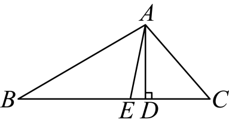

# Mathematics - 题目 95

**ID**: 6e6b1ada6a9e49319d98b01c8173ae72
**年级**: Grade 8
**难度**: Easy
**题型**: Multiple-choice

## 题目
如图，AD，AE分别是 ${\rm △\mathit{ABC}}$ 的高和角平分线，若 ${\rm ∠\mathit{B}＝30°，∠\mathit{C}＝50°}$ ，则 ${\rm ∠\mathit{DAE}}$ 的度数为（      ）​​​​​​​‌

## 解答

1. 解：∵ ${\rm ∠\mathit{B}＝30°，∠\mathit{C}＝50°}$ ，
2. ∴ ${\rm ∠\mathit{BAC}＝180°}$ ﹣ ${\rm ∠\mathit{B}}$ ﹣ ${\rm ∠\mathit{C}＝100°}$ ，
3. 又∵AE是 ${\rm △\mathit{ABC}}$ 的角平分线，
4. ∴ ${\rm ∠\mathit{BAE}＝}\frac {1}{2}{\rm ∠\mathit{BAC}＝50°}$ ，
5. ∵AD是 ${\rm △\mathit{ABC}}$ 的高，
6. ∴ ${\rm ∠\mathit{BAD}＝90°}$ ﹣ ${\rm ∠\mathit{B}＝90°}$ ﹣30°＝60°，
7. 则 ${\rm ∠\mathit{DAE}＝∠\mathit{BAD}}$ ﹣ ${\rm ∠\mathit{BAE}＝10°}$ ，
8. 故此题答案为A．

## 知识点

**中文**:
  - 三角形内角和定理
  - 三角形的角平分线
  - 三角形的高线

**English**:
  - Angle Sum Theorem
  - Angle Bisectors
  - Altitudes

---
