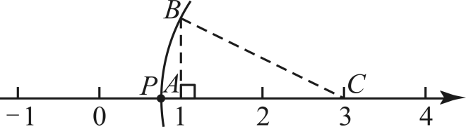

# Mathematics - 题目 3611

**ID**: 705a5a409ed14b07a2e6d4fb3d3bc991
**年级**: Grade 8
**难度**: Easy
**题型**: Multiple-choice

## 题目
如图的数轴上，点 $\mathrm{A}$ ， $C$ 对应的实数分别为1，3，线段 $AB⊥AC$ 于点 $\mathrm{A}$ ，且 $AB$ 长为1个单位长度．若以点 $C$ 为圆心， $BC$ 长为半径的弧交数轴于0和1之间的点 $P$ ，则点 $P$ 表示的实数为（      ）​​​​​​​‌

## 解答

1. 解：在直角三角形 $ABC$ 中， $BC=\sqrt {AB{^{2}}+AC{^{2}}}=\sqrt {1{^{2}}+2{^{2}}}=\sqrt {5}$ ．
2. ∴点P表示的数为 $3-\sqrt {5}$ ．
3. 故选A．

## 知识点

**中文**:
  - 勾股定理
  - 实数与数轴

**English**:
  - Pythagorean Theorem
  - Real Numbers and Number Line

---
