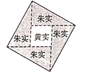

# Mathematics - 题目 1966

**ID**: 7424bbf16a534e768997414a0e9ebca8
**年级**: Grade 8
**难度**: Easy
**题型**: Multiple-choice

## 题目
如图，这个图案是3世纪我国汉代的赵爽在注释《周髀算经》时给出的，人们称它为“赵爽弦图”．赵爽根据此图指出：四个全等的直角三角形（朱实）可以围成一个大正方形，中空的部分是一个小正方形（黄实），赵爽利用弦图证明的定理是（      ）​​​​​​​‌

## 解答

1. 如图，设大正方形的边长为c，四个全等的直角三角形的两个直角边分别为a,b
2. 故小正方形的边长为（b-a）
3. ∴大正方形的面积为c^{2}=4× $\frac {1}{2}ab+{\left({b-a}\right)^{2}}$
4. 化简得 $c{^{2}}=a{^{2}}+b{^{2}}$
5. 

## 知识点

**中文**:
  - 勾股定理的应用

**English**:
  - Applications of Pythagorean Theorem

---
