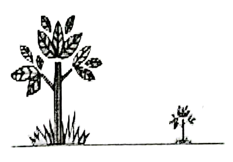

# Mathematics - 题目 172

**ID**: 82745471378f45049b5d4a8ce4a968ea
**年级**: Grade 8
**难度**: Easy
**题型**: Multiple-choice

## 题目
如图，有两颗树，一棵高10米，另一棵高4米，两树相距8米．一只鸟从一棵树的树梢飞到另一棵树的树梢，问小鸟至少飞行（      ）​​​​​​​‌

## 解答

1. 解：如图，设大树高为AB=10米，小树高为CD=4米，
2. 
3. 过C点作CE⊥AB于E，则EBDC是矩形，连接AC，
4. ∴EB=4米，EC=8米，AE=AB﹣EB=10﹣4=6米，
5. 在Rt△AEC中，
6. $AC=\sqrt {AE{^{2}}+EC{^{2}}}=\sqrt {6{^{2}}+8{^{2}}}=10$ （米）．

## 知识点

**中文**:
  - 勾股定理的应用

**English**:
  - Applications of Pythagorean Theorem

---
