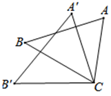

# Mathematics - 题目 3449

**ID**: 95c17688fae14547bc39c40879e26899
**年级**: Grade 8
**难度**: Easy
**题型**: Multiple-choice

## 题目
如图，△ACB≌△A′C B′，∠ACB＝70°，∠ACB′＝100°，则∠BCA′度数是（      ）​​​​​​​‌

## 解答

1. 解：∵ $\vartriangle $ ACB≌ $\vartriangle $ A′CB′，
2. ∴∠A′CB′=∠ACB=70 ${}^\circ $ ，
3. ∵∠ACB′=100 ${}^\circ $ ，
4. ∴∠BCB′=∠ACB′-∠ACB=30 ${}^\circ $ ，
5. ∴∠BCA′=∠A′CB′-∠BCB′=40 ${}^\circ $ ，
6. 故选：A．

## 知识点

**中文**:
  - 全等三角形的性质

**English**:
  - Properties of Congruent Triangles

---
