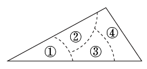

# Mathematics - 题目 3068

**ID**: 97e0cec1995245278efc146b9b0f9c67
**年级**: Grade 8
**难度**: Easy
**题型**: Multiple-choice

## 题目
如图，一块三角形的玻璃打碎成四块，现要到玻璃店去配一块完全一样的玻璃，最简单的办法是（      ）​​​​​​​‌

## 解答

1. 解：第①块只保留了原三角形的一个角和部分边，根据这块不能配一块与原来完全一样的，故 ${\rm A}$ 不符合题意；
2. 第②③块只保留了原三角形的部分边，根据这两块中的任意一块均不能配一块与原来完全一样的，故 ${\rm B}$ 不符合题意；
3. 第④块不仅保留了原来三角形的两个角，还保留了一边，则可根据 ${\rm{A}}{\rm{S}}{\rm{A}}$ 来配一块与原来一样的玻璃，故 ${\rm C}$ 符合题意；
4. 第①③块保留了原三角形的部分和一角，根据这两块不能配一块与原来完全一样的，故 ${\rm D}$ 不符合题意.
5. 故此题答案为 ${\rm{C}}$ ．

## 知识点

**中文**:
  - 角边角(ASA)

**English**:
  - ASA (Angle-Side-Angle)

---
