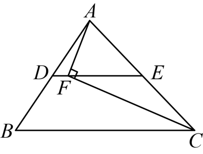

# Mathematics - 题目 1502

**ID**: d5118876bf76447aa3e7f7fade904b48
**年级**: Grade 8
**难度**: Easy
**题型**: Multiple-choice

## 题目
如图，在 $\vartriangle ABC$ 中，点D、E分别是 $AB$ 、 $AC$ 的中点， $AC=10$ ，点F是 $DE$ 上一点． $DF=1$ ．连接 $AF$ ， $CF$ ．若 $\angle AFC=90{}^\circ $ ，则 $BC$ 的长度为（      ）​​​​​​​‌

## 解答

1. 解：∵ $\angle AFC=90{}^\circ $ ，点E是 $AC$ 的中点， $AC=10$ ，
2. ∴ $EF=\frac {1}{2}AC=\frac {1}{2}\times 10=5$ ，
3. ∵ $DF=1$ ，
4. ∴ $DE=DF+FE=1+5=6$ ，
5. ∵点D、E分别是 $AB$ 、 $AC$ 的中点，
6. ∴ $BC=2DE=2\times 6=12$ ，
7. 故此题答案为D．

## 知识点

**中文**:
  - 三角形中位线
  - 直角三角形斜边上的中线

**English**:
  - Triangle Midsegment
  - Median to Hypotenuse of Right Triangle

---
