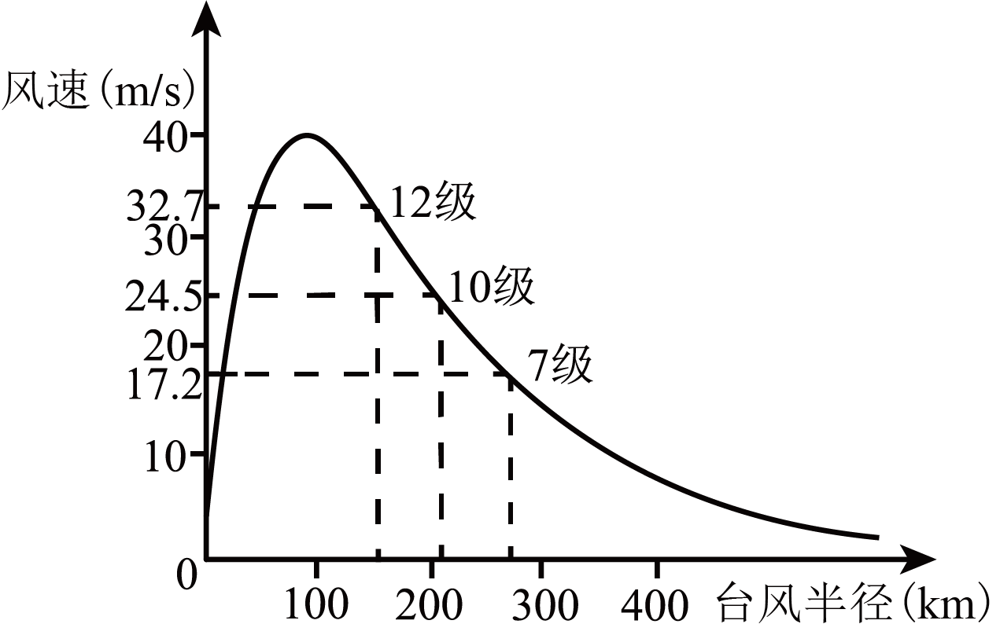

# Mathematics - 题目 473

**ID**: f6b42355013c4160a423cbb97bb2e21c
**年级**: Grade 8
**难度**: Easy
**题型**: Multiple-choice

## 题目
台风影响着人们的生产和生活．人们为研究台风，将研究条件进行一定的合理简化，把近地面风速画在一个以台风中心为原点，以台风半径为横轴，风速为纵轴的坐标系中，并在图中标注了该台风的 $12$ 级、 $10$ 级和7级风圈半径，如 $12$ 级风圈半径是指近地面风速衰减至 $32.​​​​​​​‌7{\rm{m}}/{\rm{s}}$ 时，离台风中心的距离约为 $150{\rm{k}}{\rm{m}}$ ．那么以下关于这场台风的说法中，正确的是（      ）

## 解答

1. 解：A、根据所给直角坐标系，不能判断越靠近台风中心位置，风速越大，选项说法错误，不符合题意；
2. B、距台风中心 $150{\rm{k}}{\rm{m}}$ 处，风速没有达到最大值，选项说法错误，不符合题意；
3. C、 $10$ 级风圈半径不是 $280{\rm{k}}{\rm{m}}{\rm ，}$ 选项说法错误，不符合题意；
4. D、在某个台风半径达到最大风速之后，随台风半径的增大，风速又逐渐衰减，选项说法正确，符合题意；
5. 故此题答案为D．

## 知识点

**中文**:
  - 从函数的图象获取信息

**English**:
  - Extracting Information from Graphs

---
