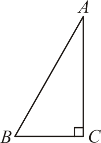
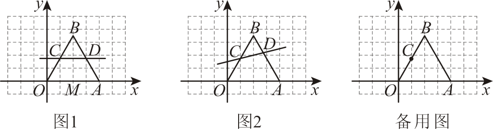

# Mathematics - 题目 1766

**ID**: 312a23998e724772ae30f01b84a0c55c
**年级**: Grade 8
**难度**: Hard
**题型**: Calculation

## 题目
如图， ${\rm{R}}{\rm{t}}\mathrm{△}ABC$ 中，若  $\angle C=90{}\degree $ ， $\angle A=30{}\degree $ ，则  $AB=2BC$ ， $AC=\sqrt {3}BC$ ．对于 $\vartriangle AOB$ 所在平面内的点 $P$ ，若 $\vartriangle AOB$ 边上存在不同的两点 $M$ ， $N$ ，使点 $P$ 关于直线 $MN$ 的对称点在 $\vartriangle AOB$ 上或其内部，则称点  $P$ 是 $\vartriangle AOB$ 的“ $MN-$ 关联点”．在平面直角坐标系 $xOy$ 中， $A\left ({4,0}\right )$ ， $\vartriangle AOB$ 是等边三角形，点 $C$  是 $OB$ 的中点，点 $D$ 是 $AB$ 边上任意一点．(1)如图 $1$ ，当点 $D$ 是边 $AB$ 的中点时，在点 $E\left ({1,0}\right )$ ， $F\left ({3,3}\right )$ ， $G\left ({4,2}\right )$ 中，点_是 $\vartriangle AOB$ 的“ $CD-$ 关联点”；​​​​​​​‌(2)如图 $2$ ，当点 $D$ 在边 $AB$ 上运动时，若点  $P$ 是 $\vartriangle AOB$ 的“ $CD-$ 关联点”，$①$ 则所有点  $P$ 的纵坐标 $t$ 的取值范围是_；$②$ 则所有点 $P$ 构成图形的周长是_；(3)当点 $D$ 在边 $AB$ 上运动时，若 $P$ 是 $\vartriangle AOB$ 的“ $CD-$ 关联点”，且 $\mathrm{△}PCD$ 是等边三角形，点 $P$  的坐标为 $\left ({m,n}\right )$ ，则 $m$ 和 $n$ 的取值范围是_．

## 解答

1. （1）解：∵ $A\left ({4,0}\right )$ ， $\vartriangle AOB$ 是等边三角形，
2. ∴ $OA=OB=AB=4$ ，
3. 过点 $B$ 作 $OA$ 的高 $BM$ ，如图所示，
4. 
5. 依题意， $OM=2,BM=2\sqrt {3}$ ，
6. ∴ $B\left ({2,2\sqrt {3}}\right )$ ，
7. ∵点 $C$  是 $OB$ 的中点，
8. ∴ $C\left ({1,\sqrt {3}}\right )$ ；
9. 当点 $D$ 是边 $AB$ 的中点时，
10. ∴ $D\left ({3,\sqrt {3}}\right )$
11. ∴ $CD{\rm{/\mskip-4mu/}}OA$ ，
12. 如图所示，作 $\mathrm{△}OAB$ 关于 $CD$ 的轴对称图形 $\mathrm{△}O^{′}MA^{′}$
13. 
14. 根据定义，可得 $\vartriangle AOB$ 的“ $CD-$ 关联点”在 $\mathrm{△}O^{′}MA^{′}$ 内，
15. 在点 $E\left ({1,0}\right )$ ， $F\left ({3,3}\right )$ ， $G\left ({4,2}\right )$ 中， $F\left ({3,3}\right )$ 在 $\mathrm{△}O^{′}MA^{′}$ 内，
16. ∴点 $F$ 是 $\vartriangle AOB$ 的“ $CD-$ 关联点”
17. （2）解：如图所示，作 $\mathrm{△}OAB$ 关于 $CD$ 的轴对称图形 $\mathrm{△}O^{′}MA^{′}$
18. 
19. 连接 $CA,CA^{′}$ ，
20. ∵ $C$ 是 $BO$ 的中点， $\mathrm{△}OAB$ 是等边三角形，依题意 $CA=\sqrt {3}OC=2\sqrt {3}$
21. ∵ $CA,CA^{′}$ 关于 $CD$ 对称，
22. ∴ $CA=CA^{′}=2\sqrt {3}$ ，
23. 又 $C\left ({1,\sqrt {3}}\right )$
24. ∴当 $CA^{′}{{\rm{/\mskip-4mu/}}}y$ 轴时， $A^{′}$ 点的纵坐标最大，最大为 $\sqrt {3}+2\sqrt {3}=3\sqrt {3}$ ，
25. 如图所示，
26. 
27. 同理可得，当 $CB^{′}{{\rm{/\mskip-4mu/}}}$  $y$ 轴时， $B^{′}$ 点的纵坐标最小，
28. ∵ $CB=2,C\left ({1,\sqrt {3}}\right )$
29. ∴此时 $B^{′}{\left ({1,\sqrt {3}-2}\right )}$
30. ∵点 $P$ 是 $\vartriangle AOB$ 的“ $CD-$ 关联点”
31. ∴所有点  $P$ 的纵坐标 $t$ 的取值范围是 $\sqrt {3}-2\leqslant t\leqslant 3\sqrt {3}$
32. ②∵ $CB=CO$ ,
33. 当点 $D$ 在边 $AB$ 上运动时，当点 $D$ 与 $\mathrm{A}$ 重合，则 $\vartriangle A^{′}O^{′}B^{′}$ 与 $\vartriangle ABO$ 重合，
34. 当点 $D$ 与 $B$ 重合时，如图所示， $CD$ 与 $OB$ 重合，则 $A^{′},C,A$ 三点共线，此时 $\angle ACA^{′}=180{}\degree $
35. 又∵ $CA=CA^{′}=2\sqrt {3}$
36. ∴ $A^{′}$ 在以 $C$ 为圆心 $2\sqrt {3}$ 为半径的半圆上运动， $O^{′},B^{′}$ 分别在 $C$ 为圆心 $2$ 为半径的圆弧上运动，
37. 
38. 其中， $ON=OM=MA=AN=2$ ，则 $\vartriangle CON,\vartriangle COM$ 为等边三角形，
39. ∴ $\angle OCM=\angle OCN=60{}\degree $
40. ∵ $P$ 在 $\vartriangle A^{′}O^{′}B^{′}$ 内部，
41. 如图所示，阴影部分即为所有点 $P$ 的轨迹，
42. 
43. ∴所有点 $P$ 构成图形的周长是 $\frac {120}{360}\times 2{\rm{π}}\times CO+MA+AN+\frac {1}{2}\times 2{\rm{π}}\times CA=\frac {2}{3}{\rm{π}}\times 2+4+{\rm{π}}\times 2\sqrt {3}=\left ({\frac {4}{3}+2\sqrt {3}}\right ){\rm{π}}+4$
44. （3）如图所示，取 $AB$ 的中点 $T$ ，连接 $CT$ ，
45. 当 $P$ 点在 $CD$ 的上方时，
46. 
47. ∵ $A\left ({4,0}\right )$ ， $B\left ({2,2\sqrt {3}}\right )$
48. ∴ $T$  $\left ({3,\sqrt {3}}\right )$ ，
49. ∴ $CT{\rm{/\mskip-4mu/}}OA$
50. ∴ $\angle BCT=\angle BTC=60{}\degree $
51. ∴ $\vartriangle BCT$ 是等边三角形， $\angle CTD=120{}\degree $
52. 又∵ $\mathrm{△}PCD$ 是等边三角形，
53. ∴ $\angle PCD=\angle BCT=60{}\degree $ ， $BC=CT,PC=CD$
54. ∴ $\angle BCP=\angle TCD$
55. ∴ $\vartriangle BCP≌\vartriangle TCD$ ， $BP=TD$ ，
56. ∴ $\angle CBP=\angle CTD=120{}\degree $
57. 又∵ $\angle BOA=60{}\degree $
58. ∴ $\angle CBP+\angle BOA=180{}\degree $
59. ∴ $BP{\rm{/\mskip-4mu/}}OA$ ，即 $P$ 的纵坐标为 $2\sqrt {3}$ ，即 $n=2\sqrt {3}$
60. ∵ $D$ 在 $AB$ 上运动， $AB=4$ ，当 $TD=0$ 时， $BP=0$ ，
61. ∴ $P$ 在以 $B$ 为中点，长度为 $4$ 的线段上运动，即 $P$ 的横坐标范围为 $0\leqslant m\leqslant 4$ ，结合（2）可知符合题意，
62. 当 $P$ 在 $CD$ 的下方时，如图所示，连接 $CM,MT$ ，
63. 
64. ∵ $C\left ({1,\sqrt {3}}\right ),T\left ({3,\sqrt {3}}\right ),M\left ({2,0}\right )$ ，同理可得 $\vartriangle OCM,\vartriangle MTA,\vartriangle BCT$ 都是等边三角形，且边长都为 $2$
65. ∴ $\angle CMO=\angle AMT=60{}\degree $ ，则 $\angle CMT=60{}\degree $
66. 又 $CT{\rm{/\mskip-4mu/}}OA$ ，则 $\angle TCM=\angle CMO=60{}\degree $ ，
67. ∴ $△CMT$ 是等边三角形，
68. ∴ $CM=CT$
69. ∵ $\mathrm{△}PCD$ 是等边三角形，
70. ∴ $CD=CP$ ， $\angle DCP=60{}\degree $
71. 又∵ $\angle DCP=\angle TCM=60{}\degree $ ，
72. ∴ $\angle DCT=\angle PCM$
73. ∴ $\vartriangle TCD≌\vartriangle MCP$
74. ∴ $DT=MP$ ， $\angle CMP=\angle CTD=60{}\degree $
75. ∴ $P$ 点在 $MT$ 上运动，
76. 由（2）可得 $P$ 点的轨迹在 $M$ 点右侧时，在 $x$ 轴的上方，
77. ∴当 $D$ 点在 $TA$ 上运动时， $P$ 点在第四象限，不合题意，
78. ∴ $D$ 在 $BT$ 上运动时， $P$ 点在 $MT$ 上运动，
79. ∵ $M\left ({2,0}\right )$ ， $T\left ({3,\sqrt {3}}\right )$
80. ∴ $2\leqslant m\leqslant 3$ ， $0\leqslant n\leqslant \sqrt {3}$
81. 综上所述， $0\leqslant m\leqslant 4$ ， $0\leqslant n\leqslant \sqrt {3}$ 或 $n=2\sqrt {3}$

## 知识点

**中文**:
  - 全等三角形的判定与性质
  - 等边三角形的判定与性质
  - 几何变换——轴对称综合题

**English**:
  - Determination and Properties
  - Determination and Properties
  - Axial Symmetry Comprehensive Problems

---
