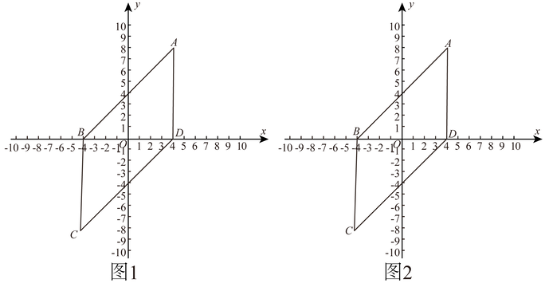

# Mathematics - 题目 23

**ID**: beb19e79e8df4b0b840f242ac3e8c6f0
**年级**: Grade 8
**难度**: Hard
**题型**: Calculation

## 题目
对于平面直角坐标系xOy中的图形M、N，给出如下定义：P为图形M上任意一点，Q为图形N上任意一点，如果P，Q两点间的距离有最小值，那么称这个最小值为图形M，N间的“近距离”，记作 $d(M，N)$ ．在 $▱ABCD$ 中，点 $A\left ({4，8}\right )$ ， $B\left ({-4，0}\right )$ ， $C\left ({-4，-8}\right )$ ， $D\left ({4，0}\right )$ ，如图 1．(1)直接写出d(点O,  $▱ABCD$ )=；​​​​​​​‌(2)若点P在y轴正半轴上，d（点P， $▱ABCD$）=4，求点P坐标；(3)已知点 $E\left ({a,-a}\right )，F\left ({a+2，-a}\right )，G\left ({a+1,-a-1}\right )，H\left ({a+3,-a-1}\right )$ ，顺次连接点E、F、H、G，将得到的四边形记为图形W（包括边界）．①当 $a=-1$ 时，在图 2 中画出图形W，直接写出 $d(W,▱ABCD)$ 的值；②若  $0\leqslant d(W,▱ABCD)<1$ ，直接写出a的取值范围．

## 解答

1. (1)
2. 解：由 $A,B,C,D$ 的点坐标可知 $O$ 为 $▱ABCD$ 对角线的交点，
3. ∴点 $O$ 到 $BC$ ， $AD$ 的距离相等且为4；点 $O$ 到 $AB$ ， $CD$ 的距离相等；
4. 如图1，记 $AB$ 与 $y$ 轴的交点为 $M$ ，
5. 
6. ∵ $AD=8=BD$ ，
7. ∴ $\angle ABD=\angle BMO=45{}^\circ $ ，
8. ∴ $OM=OB=4$ ，
9. 在 $Rt\vartriangle OBM$ 中，由勾股定理得 $BM=\sqrt {OB{^{2}}+OM{^{2}}}=4\sqrt {2}$ ，
10. 设 $O$ 到 $AB$ 的距离为 $h$ ，
11. ∴ $S{{}_{\vartriangle BOM}}=\frac {1}{2}\times OB\times OM=\frac {1}{2}BM\times h$ ，
12. ∴ $\frac {1}{2}\times 4\times 4=\frac {1}{2}\times 4\sqrt {2}\times h$ ，
13. 解得 $h=2\sqrt {2}$ ，
14. ∵ $2\sqrt {2}<4$ ，
15. ∴d(点O， $▱ABCD$ ) 的值为 $2\sqrt {2}$ ，
16. 故答案为： $2\sqrt {2}$ ．
17. (2)
18. 解：如图1，作 $PQ\bot AB$ 于 $Q$ ，
19. ∵d（点P， $▱ABCD$）=4，
20. ∴ $PQ=4$ ，
21. ∵ $\angle PMQ=\angle BMO=45{}^\circ $ ，
22. ∴ $MQ=PQ=4$ ，
23. 在 $Rt\mathrm{△}PQM$ 中，由勾股定理得 $PM=\sqrt {MQ{^{2}}+PQ{^{2}}}=4\sqrt {2}$ ，
24. ∴ $OP=4+4\sqrt {2}$ ，
25. ∴点P坐标为 $\left ({0,4+4\sqrt {2}}\right )$ ．
26. (3)
27. 解：①∵ $a=-1$ ，
28. ∴ $E(-1,1)、F(1，1)、G(0,0)、H(2,0)$ ，
29. 在坐标系中描点，依次连接如图2所示， $▱EFHG$ 即为图形 $W$ ，
30. 
31. 延长 $GE$ 交 $AB$ 于 $M$ ，交 $CD$ 于 $K$ ，延长 $FH$ ，交 $CD$ 于 $N$ ，由 $E(-1,1)$ ， $F(1，1)$ ， $G(0,0)$ ， $H(2,0)$ 可知 $\angle MGB=45{}^\circ =\angle ABD$ ，
32. ∴ $\angle OMB=90{}^\circ =\angle GKD$ ，
33. ∴ $MO=BM$ ， $ME=HN$ ，
34. 由题意知， $d(W,▱ABCD)=ME$ ，
35. ∵ $OE=\sqrt {1+1}=\sqrt {2}$ ， $OM{^{2}}+BM{^{2}}=OB{^{2}}$ ，
36. ∴ $OM=2\sqrt {2}$ ，
37. 同理 $OK=2\sqrt {2}$ ，
38. ∴ $ME=OM-OE=\sqrt {2}$ ，
39. ∴ $d(W,▱ABCD)$ 的值为 $\sqrt {2}$ ．
40. ②由 $E,F,H,G$ 的坐标可知， $EF=GH=2$ ， $EG=FH=\sqrt {2}$ ，四边形 $EFHG$ 是一个大小不变的平行四边形，且 $E$ 点沿着直线 $MK$ 运动，如图2，作 $HJ\bot EG$ 的延长线于 $J$ ，
41. ∵ $\angle JOH=\angle OHJ=45{}^\circ $ ，
42. ∴ $JG=HJ=\sqrt {2}$ ，
43. ∴ $EJ=2\sqrt {2}$ ，
44. ∴ $EJ=OK$ ，
45. 当 $0\leqslant a\leqslant 2$ 时， $W$ 与 $▱ABCD$ 有交点， $d(W,▱ABCD)=0$ ，
46. 当 $a>2$ ， $KE=1$ 时， $OE=OK+KE=2\sqrt {2}+1$ ，
47. ∴ $E\left ({2+\frac {\sqrt {2}}{2},-2-\frac {\sqrt {2}}{2}}\right )$ ，
48. ∴可知 $0\leqslant a<2+\frac {\sqrt {2}}{2}$ 时， $0\leqslant d(W,▱ABCD)<1$ ；
49. 当 $a<0$ ， $JK=1$ 时， $OE=EJ-OJ=2\sqrt {2}-\left ({2\sqrt {2}-1}\right )=1$ ，
50. ∴ $E\left ({-\frac {\sqrt {2}}{2},\frac {\sqrt {2}}{2}}\right )$ ，
51. ∴可知 $-\frac {\sqrt {2}}{2}<a<0$ 时， $0<d(W,▱ABCD)<1$ ；
52. 当 $E$ 在 $M$ 右侧且 $ME=1$ 时， $OE=2\sqrt {2}-1$ ，
53. ∴ $E\left ({-2+\frac {\sqrt {2}}{2},2-\frac {\sqrt {2}}{2}}\right )$ ，
54. 当 $J$ 在 $M$ 的左侧且 $JM=1$ 时， $OE=EJ+JM+OM=4\sqrt {2}+1$ ，
55. ∴ $E\left ({-4-\frac {\sqrt {2}}{2},4+\frac {\sqrt {2}}{2}}\right )$ ，
56. ∴可知 $-4-\frac {\sqrt {2}}{2}<a<-2+\frac {\sqrt {2}}{2}$ 时， $0\leqslant d(W,▱ABCD)<1$ ；
57. 综上所述， $a$ 的取值范围为 $-4-\frac {\sqrt {2}}{2}<a<-2+\frac {\sqrt {2}}{2}$ 或 $-\frac {\sqrt {2}}{2}<a<2+\frac {\sqrt {2}}{2}$ ．

## 知识点

**中文**:
  - 勾股定理
  - 坐标与图形性质
  - 等腰三角形的判定与性质
  - 平行四边形的判定与性质

**English**:
  - Pythagorean Theorem
  - Coordinates and Geometric Properties
  - Determination and Properties
  - Determination and Properties

---
