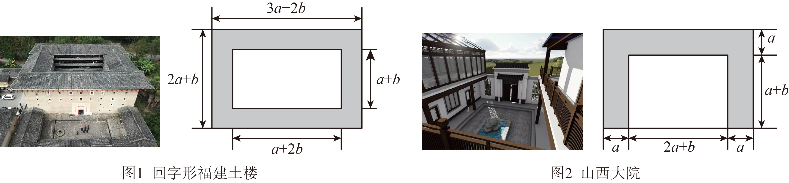

# Mathematics - 题目 3891

**ID**: 2741e4a9fe8c4f40a3da3fa0e004f005
**年级**: Grade 8
**难度**: Medium
**题型**: Calculation

## 题目
小厉、小琪在社会实践的过程中，遇到了一些各具特色的建筑，有在世界遗产大会上被正式列入《世界遗产名录》的福建土楼，也有被誉为中国民居建筑典范的山西大院，她们对于哪个建筑的占地面积（图中阴影）更大展开了讨论．①小厉认为图1中回字形福建土楼的占地面积（记为 $S{{}_{1}}$ ）更大；​​​​​​​‌②小琪认为图2中山西大院的占地面积（记为 $S{{}_{2}}$ ）更大．【数据采集】为了证明自己的想法是正确的，她们二人分别对建筑物进行了数据测量，数据如图所示．【数据应用】（1）请分别计算这两个建筑物的占地面积；（2）若 $0<a<b$ ，则（填“小厉”或“小琪”）的想法正确，并说明理由．

## 解答

1. （1）解： $S{{}_{1}}=\left ({3a+2b}\right )\left ({2a+b}\right )-\left ({a+b}\right )\left ({a+2b}\right )=6a{^{2}}+7ab+2b{^{2}}-\left ({a{^{2}}+3ab+2b{^{2}}}\right )=5a{^{2}}+4ab$ ，
2. $S{{}_{2}}=\left ({a+a+b}\right )\left ({2a+b+a+a}\right )-\left ({a+b}\right )\left ({2a+b}\right )=3a\left ({2a+b}\right )=6a{^{2}}+3ab$ ；
3. （2）解： $S{{}_{1}}-S{{}_{2}}=5a{^{2}}+4ab-\left ({6a{^{2}}+3ab}\right )=-a{^{2}}+ab=a\left ({b-a}\right )$ ，
4. ∵ $0<a<b$ ，
5. ∴ $b-a>0$ ，
6. ∴ $S{{}_{1}}-S{{}_{2}}>0$ ，
7. ∴ $S{{}_{1}}>S{{}_{2}}$ ，
8. ∴小厉的想法正确；

## 知识点

**中文**:
  - 因式分解的应用
  - 多项式乘多项式

**English**:
  - Applications of Factorization
  - Polynomial times Polynomial

---
