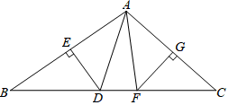

# Mathematics - 题目 3472

**ID**: 2e2d8b892ddb49178acf35b75ab7368b
**年级**: Grade 8
**难度**: Medium
**题型**: Calculation

## 题目
如图，△ABC中，∠BAC＝105°，DE、FG分别为AB、AC的垂直平分线，E、G分别为垂足．（1）求 $\angle DAF$ 的度数；​​​​​​​‌（2）如果BC=8，求△DAF的周长．

## 解答

1. 解：（1）设∠B=x，∠C=y．
2. ∵∠BAC+∠B+∠C=180°，
3. ∴105°+∠B+∠C=180°，
4. ∴x+y=75°．
5. ∵AB、AC的垂直平分线分别交BA于E、交AC于G，
6. ∴DA=BD，FA=FC，
7. ∴∠EAD=∠B，∠FAC=∠C．
8. ∴∠DAF=∠BAC-（x+y）=105°-75°=30°．
9. （2）∵AB、AC的垂直平分线分别交BA于E、交AC于G，
10. ∴DA=BD，FA=FC，
11. ∴△DAF的周长=AD+DF+AF=BD+DF+FC=BC=8．

## 知识点

**中文**:
  - 等腰三角形

**English**:
  - Isosceles Triangles

---
