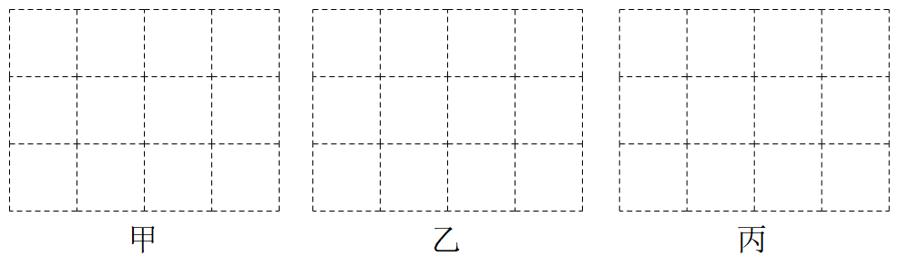

# Mathematics - 题目 1404

**ID**: 4083565b11524186aa18d908f04a95d3
**年级**: Grade 8
**难度**: Medium
**题型**: Calculation

## 题目
如图，正方形网格中的每个小正方形边长都是l，每个小格的顶点叫做格点．以格点为顶点分别按下列要求画图：（1）画出一个平行四边形，使其面积为6；​​​​​​​‌（2）画出一个菱形，使其面积为4．（3）画出一个正方形，使其面积为5．

## 解答

1. （1）图形如下,
2. 
3. （2）图形如下,
4. 
5. （3）图形如下,
6. .

## 知识点

**中文**:
  - 四边形综合

**English**:
  - Comprehensive Quadrilateral Problems

---
