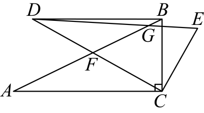

# Mathematics - 题目 2482

**ID**: 492e961c5eaa460d8d7cfbc013bb741d
**年级**: Grade 8
**难度**: Medium
**题型**: Calculation

## 题目
如图，在 $\vartriangle ABC$ 中， $\angle ACB=90{}^\circ$ ，将 $\vartriangle ABC$ 绕点 $C$ 顺时针旋转得到 $\vartriangle DEC$ ，旋转角为 $α$ ，CD，DE分别交AB于点F，G，连接BD．(1)求证： $\angle AGD=α$ ；​​​​​​​‌(2)若 $BC=2，a=30{}^\circ$ ， $BD{\rm{/\mskip-4mu/}}AC$ ，求AB的长．

## 解答

1. （1）证明：由旋转得, $\angle CDE=\angle CAB{\rm{，}}\angle ACD=α$ ，
2. $\because \angle AFD=\angle CDE+\angle AGD=\angle CAB+\angle ACD$ ，
3. $\therefore \angle AGD=α$ ；
4. （2）解： $\because BD{\rm{/\mskip-4mu/}}AC{\rm{，}}\angle ACB=90{}^\circ $ ，
5. $\therefore \angle CDB{\rm{=}}\angle ACD=α=30{}^\circ {\rm{，}}\angle CBD+\angle ACB=180{}^\circ $ ，
6. $\therefore \angle CBD=90{}^\circ $ ，
7. $\therefore CD=2BC=4$ ，
8. 由旋转得  $AC=CD=4$ ，
9. 在 ${\rm{R}}{\rm{t}}\mathrm{△}ABC$ 中， $AB=\sqrt {AC{^{2}}+BC{^{2}}}=\sqrt {4{^{2}}+2{^{2}}}=2\sqrt {5}$ ．

## 知识点

**中文**:
  - 三角形的外角性质
  - 勾股定理
  - 旋转的性质

**English**:
  - Exterior Angle Properties
  - Pythagorean Theorem
  - Properties of Rotation

---
