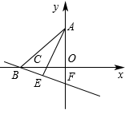

# Mathematics - 题目 3907

**ID**: 50a651d060de4a87b8e706f05e71900f
**年级**: Grade 8
**难度**: Medium
**题型**: Calculation

## 题目
如图 在平而直角坐标系中， $OA=OB$ ， $\mathrm{△}OAB$ 的面积是2． $AC$ 平分 $\angle BAO$ ，交x轴于点C，过点B作 $AC$ 的垂线交 $AC$ 的延长线于点E，交y轴于点F，垂足为E．（1）求点A和点B的坐标；​​​​​​​‌（2）求证 $\vartriangle ACO\cong \vartriangle BFO$ ；（3） $AB=2\sqrt {2}$ ，在x轴上找一点P，使 $\vartriangle ABP$ 是以AB为腰的等腰三角形．请直接写出点P的坐标．

## 解答

1. （1）∵ $\mathrm{△}OAB$ 的面积是2，
2. ∴ $\frac {1}{2}OA\cdot OB=2$ ．
3. ∵ $OA=OB$ ，
4. ∴ $OA=OB=2$ ．
5. ∴ $A\left ({0,2}\right )$ ， $B\left ({-2,0}\right )$ ．
6. （2）证明：
7. ∵ $AE\bot BF$ ，
8. ∴ $\angle AOC=\angle BOF=\angle BEC=90{}\degree $ ．
9. ∵ $\angle BCE=\angle ACO$ ，
10. ∴ $\angle CAO=\angle CBE$ ．
11. ∵ $AO=BO$ ，
12. ∴ $\vartriangle ACO\cong \vartriangle BFO$ ．
13. （3）∵ $AB=2\sqrt {2},OA=OB$ ，
14. ∴ $OA{^{2}}+OB{^{2}}={\left({2\sqrt {2}}\right)^{2}}$ ，
15. ∴ $OA=OB=2$ ，
16. 若P在x轴的正半轴上， $AB=AP=2\sqrt {2}$ ,
17. ∴ $OP=2$ ，
18. 则 $P\left ({2,0}\right )$ ；
19. 若P在x轴的正半轴上， $AB=BP=2\sqrt {2}$ ,
20. ∴ $OP=BP-OP=2\sqrt {2}-2$ ，
21. 则 $P\left ({2\sqrt {2}-2,0}\right )$ ；
22. 若P在x轴的负半轴上， $AB=BP=2\sqrt {2}$ ,
23. ∴ $OP=BP+OB=2\sqrt {2}+2$ ，
24. 则 $P\left ({-2\sqrt {2}-2,0}\right )$ ；
25. 综上， $P\left ({2,0}\right )$ 或 $P\left ({2\sqrt {2}-2,0}\right )$ 或 $P\left ({-2\sqrt {2}-2,0}\right )$ ．

## 知识点

**中文**:
  - 坐标与图形性质
  - 角角边(AAS)
  - 等腰三角形的性质

**English**:
  - Coordinates and Geometric Properties
  - AAS (Angle-Angle-Side)
  - Properties of Isosceles Triangles

---
