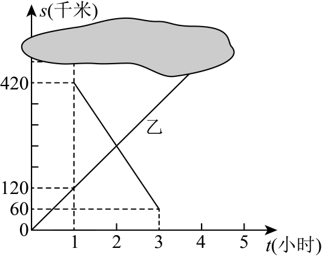

# Mathematics - 题目 3495

**ID**: 550dc41072a24dcda28e69f544fc04af
**年级**: Grade 8
**难度**: Medium
**题型**: Calculation

## 题目
甲、乙两列火车分别从A、B两城同时匀速驶出，甲车开往 $B$ 城，乙车开往A城．由于墨迹覆盖，甲车与乙车距B城的距离$s$ （千米）与时间 $t$ （小时）的函数关系部分图像如图所示．(1)甲车的速度为千米/时，A、B两地相距千米，两车出发小时后相遇；​​​​​​​‌(2)当两车相距60千米时，求t的值．

## 解答

1. （1）解：由题意可得，甲两小时行驶了 $420-60=360$ 千米，
2. ∴甲的行驶速度为： $\frac {360}{2}=180$ 千米/时，
3. 设 $S{{}_{甲}}$ 与行驶时间t的函数关系为： $S{{}_{甲}}=k{{}_{1}}t+b$ ，
4. 则： $\begin{cases}420=k{{}_{1}}+b\\60=3k{{}_{1}}+b\end{cases}$ ，
5. 解方程组得： $\begin{cases}b=600\\k{{}_{1}}=-180\end{cases}$ ，
6. ∴ $S{{}_{甲}}=-180t+600$ ，
7. 当 $t=0$ 时， $S{{}_{甲}}=600$ 千米，
8. ∴A、B两地相距600千米，
9. 设 $S{{}_{乙}}$ 与行驶时间t的函数关系为： $S{{}_{乙}}=k{{}_{2}}t$ ，
10. 则： $120=k{{}_{2}}$ ，
11. ∴ $S{{}_{乙}}=120t$ ，
12. 当 $S{{}_{甲}}=S{{}_{乙}}$ 时， $-180t+600=120t$ ，
13. 解得： $t=2$ 小时，
14. ∴两车出发2小时后相遇
15. （2）解：当相遇前两车相距60千米时： $-180t+600-120t=60$ ，
16. 解得： $t=1.8$ 小时，
17. 当相遇后两车相距60千米时： $120t-\left ({-180t+600}\right )=60$ ，
18. 解得： $t=2.2$ 小时，
19. 故t的值为： $1.8$ 小时或 $2.2$ 小时．

## 知识点

**中文**:
  - 一次函数的图象和性质
  - 行程问题
  - 待定系数法求一次函数解析式

**English**:
  - Graphs and Properties of Linear Functions
  - Distance-Speed-Time Problems
  - Finding Expressions by Undetermined Coefficients

---
