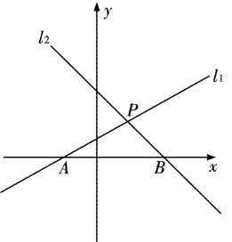

# Mathematics - 题目 142

**ID**: 64d39d1169ef4e6ab515e8a3fb65e455
**年级**: Grade 8
**难度**: Medium
**题型**: Calculation

## 题目
已知经过点 $A\left ({-1,0}\right )$ 的直线 $l{{}_{1}}$ ： $y=kx+b$ 与直线 $l{{}_{2}}$ ： $y=-x+2$ 交于点 $P$ ，点 $P$ 横坐标为 $1$ ，直线 $l{{}_{2}}$ 与 $x$ 轴交于点 $B$ ．(1)求直线 $l{{}_{1}}$ 的表达式；​​​​​​​‌(2)求 $\vartriangle PAB$ 的面积；(3)请直接写出 $kx+b>-x+2$ 时， $x$ 的取值范围．

## 解答

1. （1）∵ $P$ 点横坐标为 $1$ ，
2. 将 $x=1$ 代入 $y=-x+2$ ，得 $y=1$ ，
3. ∴ $P\left ({1,1}\right )$ ，
4. 将 $A\left ({-1,0}\right )$ ， $P\left ({1,1}\right )$ 代入 $y=kx+b$ 中，
5. 得 $\begin{cases}0=-k+b,\\1=k+b,\end{cases}$ 解得 $\begin{cases}k=\frac {1}{2},\\b=\frac {1}{2},\end{cases}$
6. ∴直线 $l{{}_{1}}$ 的表达式为 $y=\frac {1}{2}x+\frac {1}{2}$ ；
7. （2）当 $y=0$ 时， $0=-x+2$ ，则 $x=2$ ，
8. ∴ $B\left ({2,0}\right )$ ，
9. ∴ $AB=3$ ，
10. ∴ $S{{}_{\vartriangle PAB}}=\frac {1}{2}\times 3\times 1=\frac {3}{2}$ ；
11. （3）∵点 $P$ 的横坐标为 $1$ ，
12. ∴ $l{{}_{1}}$ 在 $l{{}_{2}}$ 上方时， $x>1$ ．
13. ∴ $kx+b>-x+2$ 时， $x$ 的取值范围为 $x>1$ ．

## 知识点

**中文**:
  - 一次函数与一元一次不等式
  - 待定系数法求一次函数解析式
  - 几何问题

**English**:
  - Linear Functions and Linear Inequalities
  - Finding Expressions by Undetermined Coefficients
  - Geometry Problems

---
