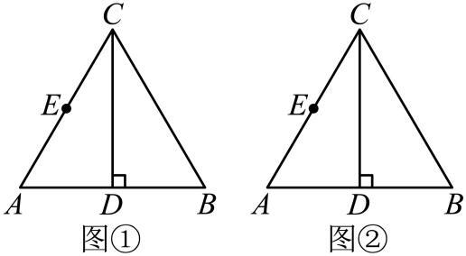

# Mathematics - 题目 2923

**ID**: 6acc046991274b638ef8ed9898d3b2fa
**年级**: Grade 8
**难度**: Medium
**题型**: Calculation

## 题目
如图， $\vartriangle ABC$ 为等边三角形， $CD$ 为边 $AB$ 上的高，点 $E$ 为 $AC$ 边上的中点，请仅用无刻度的直尺按要求作图．(1)在图①中，作 $∠A$ 的平分线 $AF$ ；​​​​​​​‌(2)在图②中，以点 $B$ 为顶点作三角形，使所作三角形面积等于 $\vartriangle ABC$ 面积的 $\frac {1}{8}$ ．

## 解答

1. （1）解： $∠A$ 的平分线 $AF$ 如图所示：
2. 过程如下：
3. 因为 $\vartriangle ABC$ 为等边三角形， $CD$ 为边 $AB$ 上的高，
4. 所以 $CD$ 为 $∠ACB$ 的平分线，
5. 因为点 $E$ 为 $AC$ 边上的中点，
6. 故 $BE$ 为边 $AC$ 的中线， $BE$ 为 $∠CBA$ 的平分线，
7. 故先连接 $EB$ 交 $CD$ 于一点，然后连接点A与该点并延长交 $BC$ 于一点，即为点 $F$ （三角形的三条角平分线会交于一点）
8. 
9. （2）解：连接 $DF$ 交 $BE$ 于一点，即点 $M$ ，
10. 由（1）得，点 $F$ 是 $CB$ 的中点，点 $D$ 是 $AB$ 的中点，
11. 则 $AF$ 是 $\vartriangle ABC$ 的中线，
12. 所以 $S{{}_{\mathrm{△}ABF}}=\frac {1}{2}S{{}_{\mathrm{△}ABC}}$
13. 因为点 $D$ 是 $AB$ 的中点，
14. 所以 $DF$ 是 $\mathrm{△}ABF$ 的中线
15. 则 $S{{}_{\vartriangle BDF}}=\frac {1}{2}S{{}_{\vartriangle ABF}}$
16. 因为 $\vartriangle ABC$ 为等边三角形，点 $D$ 是 $AB$ 的中点，点 $F$ 是 $CB$ 的中点，
17. 所以 $\vartriangle BDF$ 是等边三角形，
18. 故 $S{{}_{\vartriangle MBD}}=S{{}_{\vartriangle MBF}}=\frac {1}{2}S{{}_{\vartriangle BDF}}$ ,
19. 那么 $S{{}_{\vartriangle MBD}}=S{{}_{\vartriangle MBF}}=\frac {1}{8}S{{}_{\vartriangle ABC}}$
20. $\vartriangle BMF$ （或 $\vartriangle BDM$ ）即为所求
21. 

## 知识点

**中文**:
  - 三角形的中线
  - 等腰三角形的性质
  - 等边三角形的性质

**English**:
  - Medians
  - Properties of Isosceles Triangles
  - Properties of Equilateral Triangles

---
