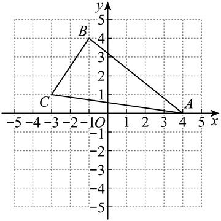

# Mathematics - 题目 1532

**ID**: 717a33264d7f4aff83a8ad2273c6f7ec
**年级**: Grade 8
**难度**: Medium
**题型**: Calculation

## 题目
如图，在平面直角坐标系中， $\vartriangle ABC$ 各顶点的坐标分别为 $A\left ({4,0}\right ),B\left ({-1,4}\right ),C\left ({-3,1}\right )$ ．（1）在图中作 $\vartriangle A^{′}B^{′}C^{′}$ ，使 $\vartriangle A^{′}B^{′}C^{′}$ 和 $\vartriangle ABC$ 关于 $x$ 轴对称；​​​​​​​‌（2）写出点 $A^{′},B^{′},C^{′}$ 的坐标．

## 解答

1. （1）解： $\vartriangle A^{′}B^{′}C^{′}$ 如图所示．
2. 
3. （2）点 $A^{′}$ 的坐标为 $\left ({4,0}\right )$ ，点 $B^{′}$ 的坐标为 $\left ({-1,-4}\right )$ ，点 $C^{′}$ 的坐标为 $\left ({-3,-1}\right )$ ．

## 知识点

**中文**:
  - 点的坐标
  - 画轴对称图形

**English**:
  - Coordinates of Points
  - Drawing Axially Symmetric Figures

---
