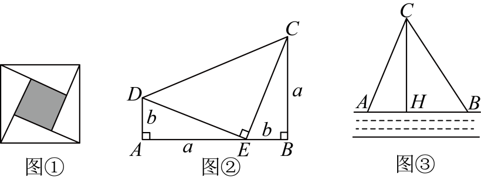

# Mathematics - 题目 544

**ID**: 760d3f5ef19f43919828996643af4e22
**年级**: Grade 8
**难度**: Medium
**题型**: Calculation

## 题目
著名的赵爽弦图（如图①，其中四个直角三角形较大的直角边长都为a，较小的直角边长都为b，斜边长都为c），由此推导出直角三角形的三边关系：如果直角三角形两条直角边长为a，b，斜边长为c，则 $a{^{2}}+b{^{2}}=c{^{2}}$ ．(1)图②为美国第二十任总统伽菲尔德的“总统证法”，请你利用图②推导上面的关系式．利用以上所得的直角三角形的三边关系进行解答；​​​​​​​‌(2)如图③，在一条东西走向河流的一侧有一村庄C，河边原有两个取水点A，B，其中 $AB=AC$ ，由于某种原因，由C到A的路现在已经不通，该村为方便村民取水决定在河边新建一个取水点H（A、H、B条直线上），并新修一条路 $CH$ ，且 $CH\bot AB$ ．测得 $CH=6$ 千米， $HB=4$ 千米，求原路 $CA$ 长多少千米？

## 解答

1. （1）解：∵ $AB\bot AD$ ， $BC\bot AB$ ， $DE\bot CE$ ，
2. ∴梯形 $ABCD$ 的面积为 $\frac {1}{2}\left ({a+b}\right )\left ({a+b}\right )$ 或 $\frac {1}{2}c{^{2}}+ab$ ，
3. ∴ $\frac {1}{2}\left ({a+b}\right )\left ({a+b}\right )=\frac {1}{2}c{^{2}}+ab$ ，
4. ∴ $ab+\frac {1}{2}c{^{2}}=\frac {1}{2}a{^{2}}+ab+\frac {1}{2}b{^{2}}$ ，
5. 即 $a{^{2}}+b{^{2}}=c{^{2}}$ ；
6. （2）解：设 $CA=AB=x$ 千米，则 $AH=\left ({x-4}\right )$ 千米，
7. 在 ${\rm{R}}{\rm{t}}\vartriangle ACH$ 中， $CA{^{2}}=CH{^{2}}+AH{^{2}}$ ，即 $x{^{2}}=6{^{2}}+{\left({x-4}\right)^{2}}$ ，
8. 解得 $x=6.5$ ，即 $CA=6.5$ ，
9. 答：原路 $CA$ 长6.5千米．

## 知识点

**中文**:
  - 勾股定理的应用
  - 勾股定理的证明

**English**:
  - Applications of Pythagorean Theorem
  - Proof of Pythagorean Theorem

---
