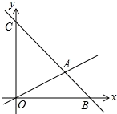

# Mathematics - 题目 2464

**ID**: 7bdf038c3a634c56beb25ace81c5a687
**年级**: Grade 8
**难度**: Medium
**题型**: Calculation

## 题目
如图,在平面直角坐标系中,过点B(6,0)的直线AB与直线OA相交于点A(4,2)，与y轴相交于点C，动点M在线段OA和射线AC上运动．(1)求直线AB的解析式；(2)若△OMC的面积是△OAC的面积的 $\frac {1}{4}$ ，请直接写出此时点M的坐标.​​​​​​​‌

## 解答

1. 试题分析：（1）利用待定系数法即可求得函数的解析式；
2. （2）根据面积公式即可求得M的横坐标，然后代入解析式即可求得M的坐标．
3. 试题解析：
4. （1）设直线AB的解析式是y=kx+b，根据题意得：
5. $\begin{cases}4k+b＝2\\6k+b＝0\end{cases}$
6. 解得： $\begin{cases}k＝-1\\b＝6\end{cases}$
7. 则直线的解析式是：y=-x+6；
8. （2）设OA的解析式是y=mx，则4m=2，
9. 解得：m＝ $\frac {1}{2}$ ，
10. 则直线的解析式是：y= $\frac {1}{2}x$ ，
11. ∵当△OMC的面积是△OAC的面积的 $\frac {1}{4}$ 时，
12. ∴当M的横坐标是 $\frac {1}{2}$ ×4=2，
13. 在y= $\frac {1}{2}$x中，当x=1时，y= $\frac {1}{2}$ ，则M的坐标是（1， $\frac {1}{2}$ ），
14. 在y=-x+6中，x=1则y=5，则M的坐标是（1，5）．
15. 则M的坐标是：M_{1}（1， $\frac {1}{2}$ ）或M2（1，5）．
16. 当M的横坐标是：-1，
17. 在y= $\frac {1}{2}$x中，当x=-1时，y=7，则M的坐标是（-1，7）；
18. 综上所述：M的坐标是：M_{1}（1， $\frac {1}{2}$ ）或M_{2}（1，5）或M_{3}（-1，7）．

## 知识点

**中文**:
  - 一次函数的图象和性质
  - 待定系数法求一次函数解析式

**English**:
  - Graphs and Properties of Linear Functions
  - Finding Expressions by Undetermined Coefficients

---
