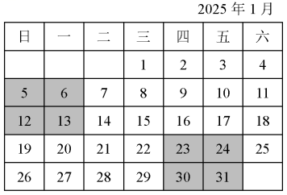

# Mathematics - 题目 1553

**ID**: 7f3e929e05ee47d692578cb4c6d77f14
**年级**: Grade 8
**难度**: Medium
**题型**: Calculation

## 题目
在日历上，我们可以发现其中某些数满足一定的规律，如图是2025年1月份的日历．我们任意选择其中所示的方框部分，将每个方框部分中4个位置上的数交叉相乘，再相减，例如： $6\times 12-5\times 13=7$ ， $24\times 30-23\times 31=7$ ，不难发现结果都是7．(1)请你按上述方法在题目的日历中再框选4个数，并写出算式（直接写出算式即可）；​​​​​​​‌(2)按上面的规律归纳出一个一般性的结论（用含 $n$ 的等式表示， $n$ 为正整数）；(3)请运用有关知识，推理说明这个结论是正确的．

## 解答

1. （1）解： $10\times 16-9\times 17=7$ ；（答案不唯一，正确即可）
2. （2）解：设方框中左上角的数为 $n$ ，则
3. $(n+1)(n+7)-n(n+8)=7$
4. （3）解：左边 $=(n+1)(n+7)-n(n+8)=n{^{2}}+8n+7-n{^{2}}-8n=7$ ，
5. 右边 $=7$ ，
6. 所以左边 $=$ 右边．
7. 即 $(n+1)(n+7)-n(n+8)=7$ ．

## 知识点

**中文**:
  - 整式的混合运算
  - 规律型：数与式的变化类

**English**:
  - Mixed Operations of Polynomials
  - Patterns: Number and Expression Variations

---
