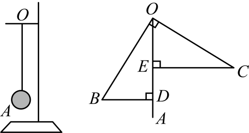

# Mathematics - 题目 151

**ID**: 7ffe261ea168425f95dec4780c90446b
**年级**: Grade 8
**难度**: Medium
**题型**: Calculation

## 题目
在一个支架的横杆点 $O$ 处用一根绳悬挂一个小球 $\mathrm{A}$ ，小球 $\mathrm{A}$ 可以摆动，如图， $OA$ 表示小球静止时的位置，当小球从 $OA$ 摆到 $OB$ 位置时，过点 $B$ 作 $BD\bot OA$ 于点 $D$ ，当小球摆到 $OC$ 位置时， $OB$ 与 $OC$ 恰好垂直，过点 $C$ 作 $CE\bot OA$ 于点 $E$ ，测得 $CE=24{\rm{c}}{\rm{m}}$ ， $OA=30{\rm{c}}{\rm{m}}$ ，求 $AD$ 的长．​​​​​​​‌

## 解答

1. 解： $\because $  $OB$ 和 $OC$ 是由 $OA$ 摆动得到，
2. $\therefore OB=CO$ ，
3. $\because $  $OB\bot OC$ ，
4. $\therefore \angle BOC=90{}\degree $ ，
5. $\because BD\bot OA$ ， $CE\bot OA$ ，
6. $\therefore \angle BDO=\angle OEC=90{}\degree $ ，
7. $\therefore \angle BOD+\angle OBD=90{}\degree $ ， $\angle BOD+\angle EOC=90{}\degree $ ，
8. $\therefore \angle OBD=\angle COE$ ，
9. 在 $\vartriangle OBD$ 和 $\vartriangle COE$ 中，
10. $\begin{cases}\angle BDO=\angle OEC\\\angle OBD=\angle COE\\OB=CO\end{cases}$ ，
11. $\therefore \vartriangle OBD≌\vartriangle COE\left ({{\rm{A}}{\rm{A}}{\rm{S}}}\right )$ ，
12. $\therefore OD=CE$ ，
13. $\because CE=24{\rm{c}}{\rm{m}},OA=30{\rm{c}}{\rm{m}}$ ，
14. $\therefore AD=OA-OD=OA-CE=6{\rm{c}}{\rm{m}}$ ．

## 知识点

**中文**:
  - 全等三角形实际应用
  - 全等三角形的判定与性质

**English**:
  - Applications of Congruent Triangles
  - Determination and Properties

---
