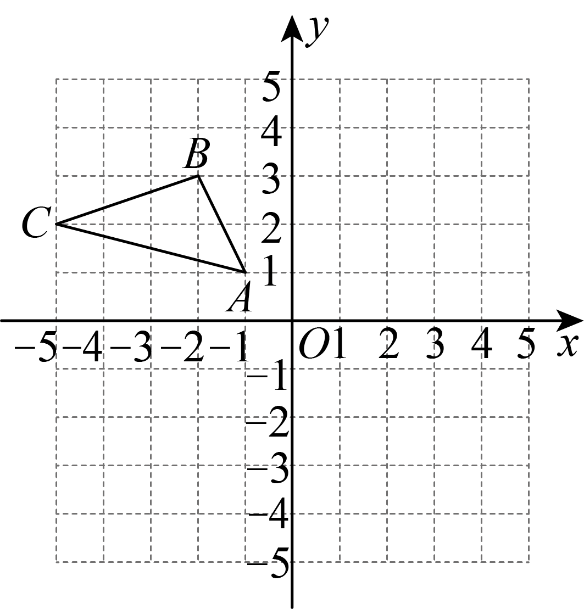

# Mathematics - 题目 2207

**ID**: 8dfe7f44b1784c378a85938b25b0ff20
**年级**: Grade 8
**难度**: Medium
**题型**: Calculation

## 题目
如图，在正方形网格中，每个小正方形的边长都是1个单位长度，在平面直角坐标系中， $\mathrm{△}ABC$ 的三个顶点坐标分别为 $A\left ({-1,1}\right )$ ， $B\left ({-2,3}\right )$ ， $C\left ({-5,2}\right )$ ．(1)画出 $\mathrm{△}ABC$ 关于 $y$ 轴对称的 $\mathrm{△}A{{}_{1}}B{{}_{1}}C{{}_{1}}$ ，并写出点 $A{{}_{1}}$ ， $C{{}_{1}}$ 的坐标；​​​​​​​‌(2)画出 $\mathrm{△}A{{}_{1}}B{{}_{1}}C{{}_{1}}$ 关于 $x$ 轴对称的 $\mathrm{△}A{{}_{2}}B{{}_{2}}C{{}_{2}}$ ，并写出点 $A{{}_{2}}$ ， $C{{}_{2}}$ 的坐标；(3)在y轴上找一点P，使 $PB{{}_{1}}+PC{{}_{1}}$ 的值最小．

## 解答

1. （1）解：如图所示， $\mathrm{△}A{{}_{1}}B{{}_{1}}C{{}_{1}}$ 即为所求， $A{{}_{1}}\left ({1,1}\right )$ ， $C{{}_{1}}\left ({5,2}\right )$ ,
2. 
3. （2）解：如图所示， $\mathrm{△}A{{}_{2}}B{{}_{2}}C{{}_{2}}$ 即为所求， $A{{}_{2}}\left ({1,-1}\right )$ ， $C{{}_{2}}\left ({5,-2}\right )$ .
4. 
5. （3）解：如图所示，点P即为所求.
6. 

## 知识点

**中文**:
  - 坐标与图形变化——轴对称
  - 画轴对称图形

**English**:
  - Coordinates and Axial Symmetry
  - Drawing Axially Symmetric Figures

---
