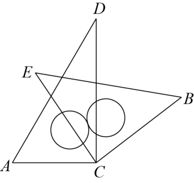

# Mathematics - 题目 1231

**ID**: 914b4188cc444ec0a1b5e44fdf36dca7
**年级**: Grade 8
**难度**: Medium
**题型**: Calculation

## 题目
将一副三角板中的两块直角三角板的直角顶点 $C$ 按如图方式叠放在一起，友情提示： $\angle A=60{}^\circ $ ， $\angle D=30{}^\circ $ ， $\angle E=\angle B=45{}^\circ $ .​​​​​​​‌（1）①若 $\angle DCE=50{}^\circ $ ，则 $∠ACB$ 的度数为；②若 $\angle ACB=120{}^\circ $ ，则 $∠DCE$ 的度数为.（2）由（1）猜想 $∠ACB$ 与 $∠DCE$ 的数量关系，并说明理由；（3）当 $\angle ACE<90{}^\circ $ 且点 $E$ 在直线 $AC$ 的上方时，当这两块角尺有一组边互相平行时，请直接写出 $∠ACE$ 角度所有可能的值.

## 解答

1. 解：（1）①∵∠DCE=50°，∠ACD=90°
2. ∴∠ACE=40°
3. ∵∠BCE=90°
4. ∴∠ACB=90°+40°=130°
5. 故此题答案为130；
6. ②∵∠ACB=120°，∠ECB=90°
7. ∴∠ACE=120°-90°=30°
8. ∴∠DCE=90°-∠ACE=90°-30°=60°
9. 故此题答案为60°；
10. 
11. （2）猜想： $\angle ACB+\angle DCE=180{}^\circ $
12. 理由如下： $\because \angle ACE=90{}^\circ -\angle DCE$
13. 又 $\because \angle ACB=\angle ACE+90{}^\circ $
14. $\therefore \angle ACB＝90{}^\circ -\angle DCE+90{}^\circ =180{}^\circ -\angle DCE$
15. 即 $\angle ACB+\angle DCE=180{}^\circ $ ；
16. （3） $30{}^\circ $ 、 $45{}^\circ $ ，
17. 理由：当CB∥AD时，∠ACE=30°；
18. 当EB∥AC时，∠ACE=45°．

## 知识点

**中文**:
  - 平行线性质的应用
  - 直角三角形的性质

**English**:
  - Applications of Properties
  - Properties of Right Triangles

---
