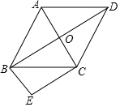

# Mathematics - 题目 3873

**ID**: aa7a99ee81654ae38582304470e228f5
**年级**: Grade 8
**难度**: Medium
**题型**: Calculation

## 题目
如图，平行四边形 $ABCD$ 的对角线 $AC$ 、 $BD$ 相较于点O，且 $AB=AD$ ， $BE{\rm{/}}{\rm{/}}AC$ ， $CE{\rm{/}}{\rm{/}}DB$ ．求证：四边形 $OBEC$ 是矩形．​​​​​​​‌

## 解答

1. 证明：∵四边形 $ABCD$ 是平行四边形且 $AB=AD$
2. ∴平行四边形 $ABCD$ 是菱形
3. ∴ $BD\bot AC$ ，即 $\angle BOC=90{^{\circ }}$
4. 又∵ $BE{\rm{/}}{\rm{/}}AC$ ， $CE{\rm{/}}{\rm{/}}DB$ ．
5. ∴四边形 $OBEC$ 是平行四边形，
6. ∴平行四边形 $OBEC$ 是矩形．
7. 

## 知识点

**中文**:
  - 矩形的判定

**English**:
  - Determination of Rectangles

---
