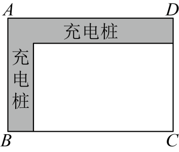

# Mathematics - 题目 211

**ID**: b0e32fe9fd904d978de4206b80b213b0
**年级**: Grade 8
**难度**: Medium
**题型**: Calculation

## 题目
新能源汽车通过激活产业链、技术革新、消费扩张与绿色转型，是国内大循环的核心驱动力之一，电车成为越来越多人购车的首选．某停车场为了解决充电难的问题，现将长为120米，宽为80米的矩形停车场进行改造．如图，将矩形 $ABCD$ 停车场的长和宽分别减少相等的宽度，减少的这部分区域用于修建充电桩，已知剩余停车场的面积为4500平方米．（1）求减少的宽度是多少米？（2）为确保安全，停车场充电桩区域须划分独立防火区，停车场物业公司准备在充电桩区域与非充电桩区域之间修建防火隔离墙．若防火隔离墙的高度为 $1.​​​​​​​‌5$ 米，则需要修建的防火隔离墙的面积是多少平方米？

## 解答

1. （1）解：设减少的长度是x米．
2. 根据题意，得 $\left ({120-x}\right )\left ({80-x}\right )=4500$ ，
3. 解得： $x{{}_{1}}=170$ （不合题意，舍去）， $x{{}_{2}}=30$ ．
4. 答：减少的长度是30米．
5. （2）解：∵减少的长度是30米，
6. ∴非充电桩区域的长为 $90$ 米，宽为 $50$ 米，
7. ∵停车场物业公司准备在充电桩区域与非充电桩区域之间修建防火隔离墙．
8. ∴修建的防火隔离墙的面积是 $2\times \left ({90+50}\right )\times 1.5=420$ （平方米）.

## 知识点

**中文**:
  - 几何问题

**English**:
  - Geometry Problems

---
