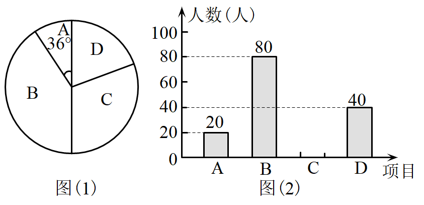

# Mathematics - 题目 3137

**ID**: c025776a488e4f20b34e6366e6f05c14
**年级**: Grade 8
**难度**: Medium
**题型**: Calculation

## 题目
某市中小学全面开展“体艺 $2+1$ ”活动，某校根据学校实际，决定设A：篮球，B：乒乓球，C：声乐，D：健美操等四种活动项目，为了解学生最喜欢一种活动项目，随机抽取了部分学生进行调查，并将调查结果绘制了两幅不完整统计图．请回答下列问题：(1)这次被调查的学生共有_人．(2)请你将统计图2补充完整．(3)统计图1中D项目对应的扇形的圆心角是_度．(4)已知该校学生4000人，请根据调查结果估计该校最喜欢乒乓球的学生人数．​​​​​​​‌

## 解答

1. （1）根据喜欢篮球的人数为20人，所占百分比为 $\frac {36{}^\circ }{360{}^\circ }\times 100\%=10\%$ ，
2. 故这次被调查的学生共有： $20\div 10\%=200$ ；
3. 故答案为：200；
4. （2）根据喜欢 $C$ 音乐的人数 $=200-20-80-40=60$ ，
5. 故 $C$ 对应60人，如图所示：
6. 
7. （3）根据喜欢 $D$ ：健美操的人数为：40人，
8. 则统计图1中 $D$ 项目对应的扇形的圆心角是： $40\div 200\times 360{}^\circ =72{}^\circ $ ；
9. 故答案为：72；
10. （4）根据样本中最喜欢乒乓球的学生人数为80人，
11. 故该校学生4000人中最喜欢乒乓球的学生人数为： $\frac {80}{200}\times 4000=1600$ 人．
12. 答：该校最喜欢乒乓球的学生人数大约为1600人．

## 知识点

**中文**:
  - 扇形统计图
  - 用样本估计总体
  - 条形统计图

**English**:
  - Pie Charts
  - Estimating Population from Sample
  - Bar Charts

---
