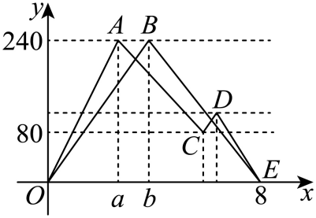

# Mathematics - 题目 2740

**ID**: cdf6c64ccd734127bee42aa03626c747
**年级**: Grade 8
**难度**: Medium
**题型**: Calculation

## 题目
甲乙两车同时从A地出发去相距240千米的B地运送物资，去时甲车比乙车提前一个小时到达．到达后，乙车原路原速返回，甲车由于重载，放慢速度返回，计划和乙车同时到达A地．甲车在距离A地80千米时发现，有一包货物遗落在途中便以60千米/小时的速度原路返回，找到并装上货物后，立即仍以60千米/小时的速度赶往A地，恰好和乙车同时到达A地．（装卸货时间忽略不计）（1） $a=$， $b=$（2）求甲车拾到货物返回A地时的图象函数解析式．（3）求甲乙两车在返回途中，最远相距多少千米？​​​​​​​‌

## 解答

1. （1）解：由图象得，乙车从A地出发去B地，再原路原速返回A地，共需要8小时，
2. ∴ $b=8\div 2=4$ ，
3. ∵去时甲车比乙车提前一个小时到达，
4. ∴ $a=b-1=4-1=3$ .
5. （2）解：∵甲车计划和乙车同时到达A地，
6. ∴甲车从返回到距离A地80千米时的速度为 $240\div \left ({8-3}\right )=48$ （千米/小时），
7. ∴甲车返回至距离A地80千米用时 $\left ({240-80}\right )\div 48=\frac {10}{3}$ （小时），
8. ∴点 $C$ 的坐标为 $\left ({3+\frac {10}{3},80}\right )$ ，即 $\left ({\frac {19}{3},80}\right )$ ，
9. 设甲车从距离A地80千米的地点到拾到货物之间的距离为 $x$ 千米，
10. 则 $\frac {x}{60}+\frac {x+80}{60}=8-\frac {19}{3}$ ，
11. 解得： $x=10$ ，
12. 则 $\frac {x}{60}=\frac {10}{60}=\frac {1}{6}$ ，
13. ∴点 $D$ 的坐标为 $\left ({\frac {19}{3}+\frac {1}{6},80+10}\right )$ ，即 $\left ({\frac {13}{2},90}\right )$ ，
14. 设甲车拾到货物返回A地时的图象函数解析式为 $y=kx+b$ ，
15. 代入 $D\left ({\frac {13}{2},90}\right )$ 和 $E\left ({8,0}\right )$ 得， $\begin{cases}\frac {13}{2}k+b=90\\8k+b=0\end{cases}$ ，
16. 解得： $\begin{cases}k=-60\\b=480\end{cases}$ ，
17. ∴甲车拾到货物返回A地时的图象函数解析式为 $y=-60x+480\left ({\frac {13}{2}\leqslant x\leqslant 8}\right )$ ；
18. （3）解：由图象得，甲乙两车在返回途中，相距最远发生在甲车返回去拾取货物之前，
19. 设直线 $AC$ 的解析式为 $y=k^{′}x+b^{′}$ ，
20. 代入 $A\left ({3,240}\right )$ 和 $C\left ({\frac {19}{3},80}\right )$ ，得 $\begin{cases}3k^{′}+b^{′}=240\\\frac {19}{3}k^{′}+b^{′}=80\end{cases}$ ，
21. 解得： $\begin{cases}k^{′}=-48\\b^{′}=384\end{cases}$ ，
22. ∴直线 $AC$ 的解析式为 $y=-48x+384$ ，
23. 同理可得直线 $BE$ 的解析式为 $y=-60x+480$ ，
24. ∴甲乙两车在返回途中，相距的距离为 $\left ({-60x+480}\right )-\left ({-48x+384}\right )=\left ({-12x+96}\right )$ 千米，
25. ∵ $-12<0$ ， $4\leqslant x\leqslant \frac {19}{3}$ ，
26. ∴当 $x=4$ 时，相距的距离有最大值 $-12\times 4+96=48$ （千米），
27. ∴甲乙两车在返回途中，最远相距48千米．

## 知识点

**中文**:
  - 从函数的图象获取信息
  - 行程问题
  - 待定系数法求一次函数解析式

**English**:
  - Extracting Information from Graphs
  - Distance-Speed-Time Problems
  - Finding Expressions by Undetermined Coefficients

---
