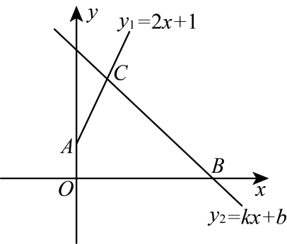

# Mathematics - 题目 2888

**ID**: cf16d5a80bb542d1a0b2173943153c95
**年级**: Grade 8
**难度**: Medium
**题型**: Calculation

## 题目
如图，一次函数 $y{{}_{1}}=2x+1$ 图象与x轴交于点A，一次函数 $y{{}_{2}}=kx+b$ 图象与x轴交于点 $B\left ({4,0}\right )$ ，两函数图象交于点 $C\left ({1,m}\right )$ ．(1)求一次函数 $y{{}_{2}}=kx+b$ 的表达式；​​​​​​​‌(2)下列说法正确的有（填序号）；①关于x的不等式 $kx+b>0$ 的解集是 $x<4$ ；②当 $0<x<4$ 时，一次函数值 $y{{}_{2}}$ 的取值范围是 $0<y<3$ ；③关于x的方程 $kx+b=2x+1$ 的解是 $x=1$ ；④关于x的不等式 $kx+b\geqslant 2x+1$ 的解集是 $x\leqslant 1$ ．(3)观察图象，请直接写出不等式 $\left ({2x+1}\right )\left ({kx+b}\right )<0$ 的解集．

## 解答

1. （1）解：∵一次函数 $y{{}_{1}}=2x+1$ 图象经过点 $C\left ({1,m}\right )$ ，
2. ∴ $m=2\times 1+1=3$ ，
3. ∴ $C\left ({1,3}\right )$ ，
4. ∵一次函数 $y{{}_{2}}=kx+b$ 图象经过点 $C\left ({1,3}\right )$ 和 $B\left ({4,0}\right )$ ，
5. ∴ $\begin{cases}k+b=3\\4k+b=0\end{cases}$ ，
6. 解得 $\begin{cases}k=-1\\b=4\end{cases}$ ，
7. ∴一次函数 $y{{}_{2}}=-x+4$ ；
8. （2）解：观察图象，
9. ①关于x的不等式 $kx+b>0$ 的解集是 $x<4$ ，说法正确；
10. ②令 $x=0$ ，则 $y{{}_{2}}=4$ ，
11. ∴当 $0<x<4$ 时，一次函数值 $y{{}_{2}}$ 的取值范围是 $0<y<4$ ，原说法错误；
12. ③关于x的方程 $kx+b=2x+1$ 的解是 $x=1$ ，说法正确；
13. ④关于x的不等式 $kx+b\geqslant 2x+1$ 的解集是 $x\leqslant 1$ ，说法正确．
14. 综上，正确的说法是①③④，
15. 故答案为①③④；
16. （3）解：∵ $\left ({2x+1}\right )\left ({kx+b}\right )<0$ ，
17. ∴ $\begin{cases}2x+1>0\\kx+b<0\end{cases}$ 或 $\begin{cases}2x+1<0\\kx+b>0\end{cases}$ ，
18. 观察图象， $\begin{cases}2x+1>0\\kx+b<0\end{cases}$ 的解集为 $x>4$ ，
19. $\begin{cases}2x+1<0\\kx+b>0\end{cases}$ 的解集为 $x<-\frac {1}{2}$ ，
20. 综上， $\left ({2x+1}\right )\left ({kx+b}\right )<0$ 的解集为 $x<-\frac {1}{2}$ 或 $x>4$ ．

## 知识点

**中文**:
  - 一次函数与一元一次不等式
  - 一次函数的图象和性质
  - 一次函数与一元一次方程
  - 待定系数法求一次函数解析式

**English**:
  - Linear Functions and Linear Inequalities
  - Graphs and Properties of Linear Functions
  - Linear Functions and Linear Equations
  - Finding Expressions by Undetermined Coefficients

---
