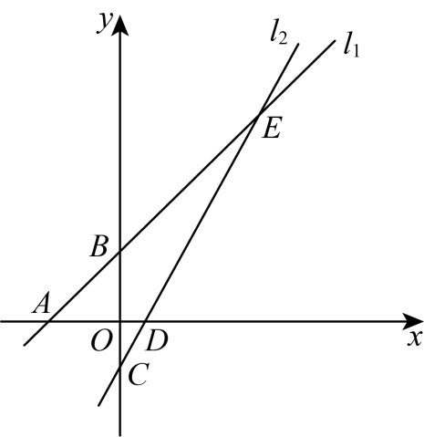

# Mathematics - 题目 3807

**ID**: dde94ef15b874270b0ed7cf62aacbb5a
**年级**: Grade 8
**难度**: Medium
**题型**: Calculation

## 题目
如图，直线 $l{{}_{1}}$ 的函数表达式为 $y=x+1$ ，且 $l{{}_{1}}$ 分别交x轴、y轴于点A，B．直线 $l{{}_{2}}$ 的函数表达式为 $y=kx+b$ ， $l{{}_{2}}$ 经过点 $C\left ({0，-1}\right )$ ，分别交x轴、直线 $l{{}_{1}}$ 于点D，E，且E点坐标为 $\left ({n，3}\right )$ ．(1)求k和b的值；​​​​​​​‌(2)求 $\vartriangle ADE$ 的面积；(3)直接写出不等式 $kx+b\mathrm{>}x+1$ 的解集．

## 解答

1. （1）解：把 $\left ({n{\rm{，}}3}\right )$ 代入 $y=x+1$ 得： $3=n+1$ ，
2. 解得： $n=2$ ，
3. ∴ $E\left ({2{\rm{，}}3}\right )$ ，
4. 把 $E\left ({2{\rm{，}}3}\right )$ ， $C\left ({0{\rm{，}}-1}\right )$ 代入 $y=kx+b$ 得： $\begin{cases}2k+b=3\\b=-1\end{cases}$ ，
5. 解得： $\begin{cases}k=2\\b=-1\end{cases}$ ；
6. （2）当 $y=x+1=0$ 时，
7. 解得： $x{\rm{=}}-{\rm{1}}$ ，
8. ∴ $A\left ({-1,0}\right )$ ，
9. 由（1）知直线 $l{{}_{2}}$ 的函数表达式为 $y=2x-1$ ，
10. 当 $y=0$ 时，即 $2x-1=0$ ，
11. 解得： $x=\frac {1}{2}$ ，
12. ∴ $D\left ({\frac {1}{2},0}\right )$ ，
13. ∵ $E\left ({2{\rm{，}}3}\right )$ ，
14. ∴ $S{{}_{\vartriangle ADE}}=\frac {1}{2}\times \left ({\frac {1}{2}+1}\right )\times 3=\frac {9}{4}$ ；
15. （3）∵ $E\left ({2{\rm{，}}3}\right )$ ，
16. ∴由函数图象可得不等式 $kx+b\mathrm{>}x+1$ 的解集为 $x>2$ ．

## 知识点

**中文**:
  - 一次函数与一元一次不等式
  - 待定系数法求一次函数解析式

**English**:
  - Linear Functions and Linear Inequalities
  - Finding Expressions by Undetermined Coefficients

---
