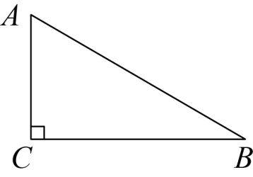

# Mathematics - 题目 2449

**ID**: df8a4bb08630469caa98dd97973fef04
**年级**: Grade 8
**难度**: Medium
**题型**: Calculation

## 题目
如图，在 $\mathrm{R}\mathrm{t}\mathrm{△}ABC$ 中， $\angle ACB\mathrm{=}90{}\degree $ ．求作：矩形ABCD．作法：①作线段AB的垂直平分线交AB于点O．②作射线CO．③以点O为圆心，线段CO长为半径画弧，交射线CO于点D．④连接AD，BD，则四边形ACBD即为所求作的矩形．（1）使用直尺和圆规，依作法补全图形（保留作图痕迹）；​​​​​​​‌（2）完成下面的证明．证明：∵ $OA=OB$ ，① $=OD$  ，∴四边形ACBD是平行四边形，（②）（填推理的依据）∵ $\angle ACB\mathrm{=}90{}\degree $ ，∴四边形ACBD是矩形．（③）（填推理的依据）

## 解答

1. （1）解：所作图如图所示．
2. 
3. （2）证明：∵OA=OB，OC=OD，
4. ∴四边形ACBD是平行四边形(对角线互相平分的四边形是平行四边形)，
5. ∵ ${\rm ∠\mathit{ACB}=90°}$ ，
6. ∴四边形ACBD是矩形(有一个角是直角的平行四边形是矩形)．

## 知识点

**中文**:
  - 尺规作图——作线段垂直平分线
  - 平行四边形的判定与性质
  - 矩形的判定

**English**:
  - Construction: Perpendicular Bisector
  - Determination and Properties
  - Determination of Rectangles

---
