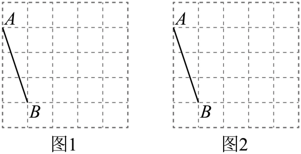

# Mathematics - 题目 1272

**ID**: ed8050f6a00b4a929db412c33d802346
**年级**: Grade 8
**难度**: Medium
**题型**: Calculation

## 题目
如图，在 $5\times 5$ 的正方形网格中，每个小正方形的顶点称为格点，每个小正方形的边长均为1，只用无刻度的直尺，在给定的网格中按条件画图，要求所画图形的顶点均在格点上．（1）在图1中以线段 $AB$ 为边画一个面积为12的平行四边形 $ABCD$ ；​​​​​​​‌（2）在图2中以线段 $AB$ 为边画一个面积为8的菱形 $ABEF$ ．

## 解答

1. （1）解：如图所示：四边形 $ABCD$ 即为所求的平行四边形；
2. 
3. （2）如图所示，四边形 $ABEF$ 即为所求的菱形；
4. $AE=\sqrt {4{^{2}}+4{^{2}}}=4\sqrt {2}$ ，
5. $BF=\sqrt {2{^{2}}+2{^{2}}}=2\sqrt {2}$ ，
6. $S{{}_{四边形ABEF}}=\frac {1}{2}\cdot AE\cdot BF=\frac {1}{2}\times 4\sqrt {2}\times 2\sqrt {2}=8$ ．

## 知识点

**中文**:
  - 一组对边平行且相等的四边形是平行四边形
  - 勾股定理
  - 菱形的判定

**English**:
  - One Pair of Parallel and Equal Opposite Sides
  - Pythagorean Theorem
  - Determination of Rhombuses

---
