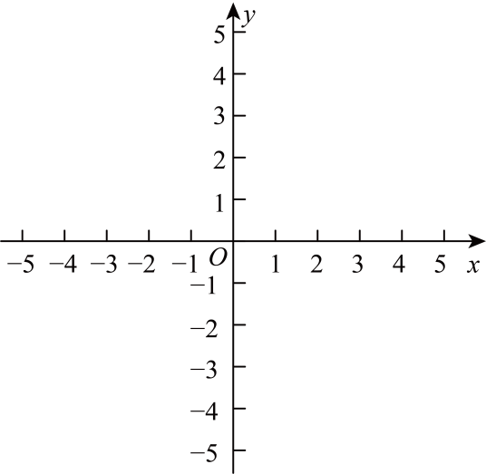

# Mathematics - 题目 2133

**ID**: fa582cf5ecdf477ebf48f36d41efc574
**年级**: Grade 8
**难度**: Medium
**题型**: Calculation

## 题目
在平面直角坐标系中，对于点P(x，y)，若点Q的坐标为 ${\rm (\mathit{ax}＋\mathit{y}，\mathit{x}＋\mathit{ay})}$ ，其中a为常数，则称点Q是点P的“a级关联点”．例如，点P(1，4)的“3级关联点”为Q(3×1＋4，1＋3×4)，即Q(7，13)．（1）已知点A(−2，6)的“ $\frac {1}{2}$ 级关联点”是点A_{1}，点B的“2级关联点”是B_{1}(3，3)，求点A_{1}和点B的坐标；​​​​​​​‌（2）已知点M(m−1，2m)的“−3级关联点”M′位于y轴上，求M′的坐标；（3）已知点C(−1，3)，D(4，3)，点N(x，y)和它的“n级关联点”N′都位于线段CD上，请直接写出n的取值范围．

## 解答

1. （1）∵点A（﹣2，6）的“ $\frac {1}{2}$ 级关联点”是点A_{1}，
2. ∴A_{1}（﹣ ${\rm 2×}\frac {1}{2}{\rm +6}$ ，﹣ ${\rm 2+}\frac {1}{2}$ ×6），
3. 即A_{1}（5，1）．
4. 设点B（x，y），
5. ∵点B的“2级关联点”是B_{1}（3，3），
6. ∴ $\begin{cases}2x+y=3\\x+2y=3\end{cases}$
7. 解得 $\begin{cases}x=1\\y=1\end{cases}$
8. ∴B（1，1）．
9. （2）∵点M（m﹣1，2m）的“﹣3级关联点”为M′（﹣3（m﹣1）+2m，m﹣1+（﹣3）×2m），
10. M′位于y轴上，
11. ∴﹣3（m﹣1）+2m=0，
12. 解得：m=3
13. ∴m﹣1+（﹣3）×2m=﹣16，
14. ∴M′（0，﹣16）．
15. （3）∵点N（x，y）和它的“n级关联点”N′都位于线段CD上，
16. ∴N′ ${\rm （\mathit{nx}+\mathit{y}，\mathit{x}+\mathit{ny}）}$ ，
17. ∴ $\begin{cases}-1\leqslant x\leqslant 4\\-1\leqslant nx+y\leqslant 4\end{cases}$  ， $\begin{cases}y=3\\x+ny=3\end{cases}$  ，
18. ∴x=3−3n,
19. ∴ $\begin{cases}-1\leqslant 3-3n\leqslant 4\\-\frac {4}{3}\leqslant n-n{^{2}}\leqslant \frac {1}{3}\end{cases}$ ,解得 $-\frac {1}{3}\leqslant n\leqslant \frac {4}{3}$ .

## 知识点

**中文**:
  - 加减消元法解二元一次方程组
  - 解一元一次不等式组
  - 点的坐标

**English**:
  - Elimination Method
  - Solving Systems of Inequalities
  - Coordinates of Points

---
