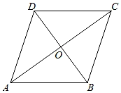

# Mathematics - 题目 2907

**ID**: 030e27887aaa4fe3913bd78b3bf63d21
**年级**: Grade 8
**难度**: Medium
**题型**: Fill-in-the-blank

## 题目
如图，四边形ABCD是边长为 $\sqrt {5}$ cm的菱形，其中对角线BD的长为2cm，则菱形ABCD的面积为cm2．​​​​​​​‌

## 解答

1. 解：∵四边形ABCD是菱形，
2. ∴BO＝DO，AC⊥DB，AO＝CO，
3. ∵BD＝2cm，
4. ∴BO＝1cm，
5. ∵AB＝ $\sqrt {5}$ cm，
6. ∴AO＝ ${\rm \sqrt {AB{^{2}}-BO{^{2}}}}$
7. ＝ $\sqrt {5-1}$ ＝2（cm），
8. ∴AC＝2AO＝4cm．
9. ∴S菱形ABCD＝ ${\rm \frac {1}{2}AC\centerdot BD=\frac {1}{2}\times 4\times 2=4}$ （cm2）．
10. 故答案为：4．

## 知识点

**中文**:
  - 菱形的性质

**English**:
  - Properties of Rhombuses

---
