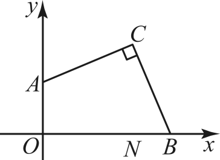

# Mathematics - 题目 3582

**ID**: 05aa5e41bada42a7b33a61198f80144b
**年级**: Grade 8
**难度**: Medium
**题型**: Fill-in-the-blank

## 题目
如图，在平面直角坐标系中，C（4，4），点B，A分别在x轴正半轴和y轴正半轴上，∠ACB＝90°，则OA＋OB＝．​​​​​​​‌

## 解答

1. 解：过C作CM⊥y轴于M，CN⊥x轴于N，
2. 
3. ∵C（4，4），∴CN=CM=4，∵x轴 ${\rm ⊥\mathit{y}}$ 轴，∴ ${\rm ∠\mathit{MON}=∠\mathit{CNO}=∠\mathit{CMO}=90°}$ ，
4. ∴ ${\rm ∠\mathit{MCN}=360°-90°-90°-90°=90°}$ ，则四边形MONC是正方形，∴OM=ON=CN=CM=4，
5. ∵ ${\rm ∠\mathit{ACB}=90°}$ ，∴ ${\rm ∠\mathit{ACB}=∠\mathit{MON}}$ ，∴ ${\rm ∠\mathit{MCA}=90°-∠\mathit{ACN}，∠\mathit{BCN}=90°-∠\mathit{ACN}}$ ，
6. ∴ ${\rm ∠\mathit{ACM}=∠\mathit{BCN}}$ ，在 ${\rm △\mathit{ACM}}$ 和 ${\rm △\mathit{BCN}}$ 中，
7. $\begin{cases}\angle ACM=\angle BCN\\CM=CN\\\angle CMA=\angle CNB\end{cases}$ ，∴ ${\rm △\mathit{ACM}}$ ≌ ${\rm △\mathit{BCN}（ASA）}$ ，∴AM=BN，
8. ∴OA+OB=OA+ON+BN=OA+ON+AM=ON+OM=4+4=8．

## 知识点

**中文**:
  - 全等三角形的判定与性质
  - 坐标与图形性质
  - 正方形的判定与性质综合

**English**:
  - Determination and Properties
  - Coordinates and Geometric Properties
  - Determination and Properties of Squares

---
