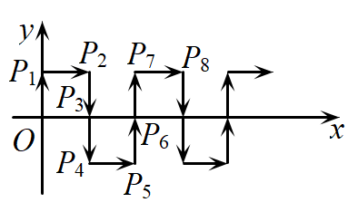

# Mathematics - 题目 212

**ID**: 0ed1c025fd604cbf85ca9db20159866e
**年级**: Grade 8
**难度**: Medium
**题型**: Fill-in-the-blank

## 题目
如图，在平面直角坐标系中，一动点从原点O出发，沿着箭头所示方向，每次移动一个单位长度，依次得到点 $P{{}_{1}}(0,1)$ ， $P{{}_{2}}(1,1)$ ， $P{{}_{3}}(1,0)$ ， $P{{}_{4}}(1,-1)$ ， $P{{}_{5}}(2,-1)$ ， $P{{}_{6}}(2,0)$  $\cdots \cdots $ 则点 $P{{}_{2022}}$ 的坐标是．​​​​​​​‌

## 解答

1. 解：由图可知 $P{{}_{3}}\left ({1,0}\right )$ ， $P{{}_{6}}\left ({2,0}\right )$ ， $P{{}_{9}}\left ({3,0}\right )$ ，…，
2. ∴ $P{{}_{3n}}\left ({n,0}\right )$ ，
3. ∵ $2022\div 3=674$ ，
4. ∴ $P{{}_{2022}}\left ({674,0}\right )$ .

## 知识点

**中文**:
  - 规律型：图形的变化类

**English**:
  - Patterns: Geometric Variations

---
