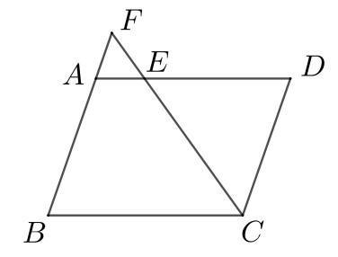

# Mathematics - 题目 3005

**ID**: 1a5fa2b26b684221bb1dd9c76ac9c801
**年级**: Grade 8
**难度**: Medium
**题型**: Fill-in-the-blank

## 题目
如图，在平行四边形ABCD中， $AB=6，BC=8，\angle BCD$ 的平分线交AD于点E，交BA的延长线于点F，则 $AE+AF$ 的值为．​​​​​​​‌

## 解答

1. 解：∵FC平分 $\angle BCD$ ，
2. ∴∠DCF＝∠BCF，
3. ∵平行四边形ABCD
4. ∴ $AD{\rm{/\mskip-4mu/}}BC$ ， $FB{\rm{/\mskip-4mu/}}DC$
5. ∴ $\angle FEA=\angle FCB，\angle AFE=\angle FCD$ ，
6. ∴ $\angle AFE=\angle FEA$ ， $\angle AFE=\angle FCB$ ，
7. ∴ $\vartriangle $FAE和 $\vartriangle $FBC是等腰三角形，
8. ∴ $AF=AE，BF=BC$ ，
9. ∵AF=BF-AB，
10. ∴AF=BC-AB=8-6=2，
11. ∴AE+AF=2AF=4，

## 知识点

**中文**:
  - 平行四边形的对边平行且相等
  - 等腰三角形的判定与性质

**English**:
  - Opposite Sides Parallel and Equal
  - Determination and Properties

---
