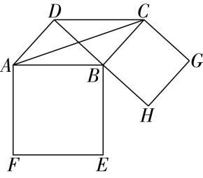

# Mathematics - 题目 1820

**ID**: 1a8f910e44c446bca4b9f1cf98b9541d
**年级**: Grade 8
**难度**: Medium
**题型**: Fill-in-the-blank

## 题目
如图，平行四边形 $ABCD$ 中， $AC=11$ ， $BD=5$ ，以 $AB$ 为边作正方形 $ABEF$ ，再以 $BC$ 为边作正方形 $BCGH$ ，若正方形 $ABEF$ 的面积为46，则正方形 $BCGH$ 的面积为．​​​​​​​‌

## 解答

1. 如图，设 $AC$ 交 $BD$ 于点 $O$ ，作 $DI\perp AC$ 于点 $I$ ，则 $\mathrm{\angle }AID=\mathrm{\angle }CID={90}^{\circ }.\because $  四边形 $ABCD$ 是平行四边形， $\therefore AB=CD$ ， $AD=BC$ ， $OD=OB=\frac{1}{2}BD$ ， $OA=OC=\frac{1}{2}AC.\because A{D}^{2}-A{I}^{2}=O{D}^{2}-O{I}^{2}=D{I}^{2}$ ， $C{D}^{2}-C{I}^{2}=O{D}^{2}-O{I}^{2}=D{I}^{2}$ ， $\therefore A{D}^{2}+C{D}^{2}=A{I}^{2}+C{I}^{2}+2O{D}^{2}-2O{I}^{2}.\because A{I}^{2}+C{I}^{2}=(OA-OI)^{2}+(OA+OI)^{2}=2O{A}^{2}+2O{I}^{2}$ ， $\therefore A{D}^{2}+C{D}^{2}=2O{A}^{2}+2O{I}^{2}+2O{D}^{2}-2O{I}^{2}=2O{A}^{2}+2O{D}^{2}.\because 2O{A}^{2}+2O{D}^{2}=2×{\left(\frac{1}{2}AC\right)^{2}}+2×{\left(\frac{1}{2}BD\right)^{2}}=\frac{1}{2}A{C}^{2}+\frac{1}{2}B{D}^{2}$ ， $\therefore A{D}^{2}+C{D}^{2}=\frac{1}{2}A{C}^{2}+\frac{1}{2}B{D}^{2}.\because AC=11$ ， $BD=5$ ， $A{B}^{2}=C{D}^{2}={S}_{正方形ABEF}=46$ ， $\therefore {S}_{正方形BCGH}=B{C}^{2}=A{D}^{2}=\frac{1}{2}A{C}^{2}+\frac{1}{2}B{D}^{2}-C{D}^{2}=\frac{1}{2}×{11}^{2}+\frac{1}{2}×{5}^{2}-46=27$ ， $\therefore $  正方形 $BCGH$ 的面积为27.故答案为27．
2. 

## 知识点

**中文**:
  - 平行四边形的对角线互相平分
  - 平行四边形的对边平行且相等

**English**:
  - Diagonals Bisect Each Other
  - Opposite Sides Parallel and Equal

---
