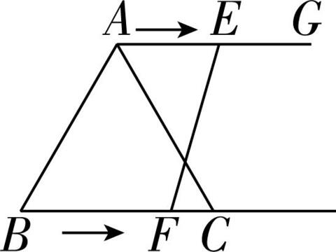

# Mathematics - 题目 2988

**ID**: 1aac1352aa0b45bead89db7eeb7d3c9c
**年级**: Grade 8
**难度**: Medium
**题型**: Fill-in-the-blank

## 题目
如图，在等边 $△ABC$ 中， $BC=5\mathrm{ }\mathrm{c}\mathrm{m}$ ，射线 $AG//BC$ ，点 $E$ 从点 $A$ 出发沿射线 $AG$ 以 $1\mathrm{ }\mathrm{c}\mathrm{m}/\mathrm{s}$ 的速度运动，点 $F$ 从点 $B$ 出发沿射线 $BC$ 以 $2\mathrm{ }\mathrm{c}\mathrm{m}/\mathrm{s}$ 的速度运动.​​​​​​​‌如果点 $E$ , $F$ 同时出发，设运动时间为 $t\mathrm{ }\mathrm{s}$ ，当 $t=$时，以 $A$ , $C$ , $E$ , $F$ 为顶点的四边形是平行四边形.

## 解答

1. ①当点 $F$ 在 $C$ 的左侧时，根据题意得 $AE=t\mathrm{ }\mathrm{c}\mathrm{m}$ ， $BF=2t\mathrm{ }\mathrm{c}\mathrm{m}$ ，则 $CF=BC-BF=(5-2t)\mathrm{ }\mathrm{c}\mathrm{m}$ . $\because AG//BC$ ， $\therefore $  当 $AE=CF$ 时，四边形 $AECF$ 是平行四边形，即 $5-2t=t$ ，解得 $t=\frac{5}{3}.\mathrm{②}$ 当点 $F$ 在 $C$ 的右侧时，根据题意得 $AE=t\mathrm{ }\mathrm{c}\mathrm{m}$ ， $BF=2t\mathrm{ }\mathrm{c}\mathrm{m}$ ，则 $CF=BF-BC=(2t-5)\mathrm{ }\mathrm{c}\mathrm{m}.\because AG//BC$ ， $\therefore $  当 $AE=CF$ 时，四边形 $AEFC$ 是平行四边形，即 $2t-5=t$ ，解得 $t=5$ .故答案为 $\frac{5}{3}$ 或5.
2. 【关键点拨】
3. 紧扣条件中有一组对边平行，由平行四边形的判定方法可知只需补充这组对边相等这一条件即可，再由运动的路程、速度与时间的关系表示出相关线段的长度，从而可列出方程进行求解.同时注意分类讨论思想的应用.

## 知识点

**中文**:
  - 平行四边形的判定与性质

**English**:
  - Determination and Properties

---
