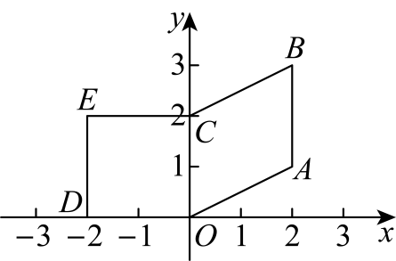

# Mathematics - 题目 3589

**ID**: 1b7ecacde4e046618857c7059f1b0fae
**年级**: Grade 8
**难度**: Medium
**题型**: Fill-in-the-blank

## 题目
如图，在平面直角坐标系中，四边形 $OABC$ 是平行四边形，四边形 $ODEC$ 为正方形，点C的坐标是 $\left ({0,2}\right )$ ，点A的坐标是 $\left ({2,1}\right )$ ，若直线l把平行四边形 $OABC$ 与正方形 $ODEC$ 组成的图形分成面积相等的两部分，则直线l的解析式是．​​​​​​​‌

## 解答

1. 解：如图，设平行四边形 $OABC$ 与正方形 $ODEC$ 的中心为点 $M，N$ ，则直线 $MN$ 就是可以将正方形与平行四边形组成的图形分成面积相等的两部分的直线l．
2. 
3. ∵点C的坐标为 $\left ({0,2}\right )$ ，
4. ∴ $OC=2$ ，
5. 又∵四边形 $ODEC$ 为正方形，
6. ∴ $OD=2$ ，
7. ∴点N的坐标为 $\left ({-1,1}\right )$ ，
8. 由平行四边形 $OABC$ 的对边相等知，
9. $AB=OC=2$ ，
10. ∵点A的纵坐标为1，
11. ∴点B的纵坐标为3，
12. 点B的坐标为 $\left ({2,3}\right )$ ，
13. 因此点M的坐标为 $\left ({1,\frac {3}{2}}\right )$ ，
14. 设直线l的解析式为 $y=kx+b$ ，
15. 将 $N\left ({-1,1}\right )$ ， $M\left ({1,\frac {3}{2}}\right )$ 代入l的解析式得，
16. $\begin{cases}1=-k+b\\\frac {3}{2}=k+b\end{cases}$ ，
17. 解得 $\begin{cases}k=\frac {1}{4}\\b=\frac {5}{4}\end{cases}$ ，
18. ∴直线l的解析式为 $y=\frac {1}{4}x+\frac {5}{4}$ ．

## 知识点

**中文**:
  - 平行四边形的对边平行且相等
  - 正方形的性质
  - 待定系数法求一次函数解析式

**English**:
  - Opposite Sides Parallel and Equal
  - Properties of Squares
  - Finding Expressions by Undetermined Coefficients

---
