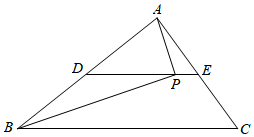

# Mathematics - 题目 156

**ID**: 1f14605c8c204ccab368f34e06984967
**年级**: Grade 8
**难度**: Medium
**题型**: Fill-in-the-blank

## 题目
如图，在Rt△ABC中，AB＝12，AC＝5，∠BAC＝90°，D、E分别为AB、AC的中点，P为DE上一点，且满足 ${\rm ∠\mathit{EAP}＝∠\mathit{ABP}}$ ，则PE＝．​​​​​​​‌

## 解答

1. 根据勾股定理求出BC，根据三角形中位线定理求出DE，根据直角三角形的性质求出PD，计算即可．
2. 【解答】解：在Rt△ABC中，AB＝12，AC＝5，
3. 由勾股定理得： ${\rm \mathit{BC}＝}\sqrt {AB{^{2}}+AC{^{2}}}=\sqrt {12{^{2}}+5{^{2}}}=13$ ，
4. ∵D，E分别为AB，AC的中点，
5. ∴ ${\rm \mathit{DE}＝}\frac {1}{2}{\rm \mathit{BC}＝}$  $\frac {13}{2}$ ，
6. ∵ ${\rm ∠\mathit{BAC}＝90°}$ ，
7. ∴ ${\rm ∠\mathit{BAP}+∠\mathit{EAP}＝90°}$ ，
8. ∵ ${\rm ∠\mathit{EAP}＝∠\mathit{ABP}}$ ，
9. ∴ ${\rm ∠\mathit{BAP}+∠\mathit{ABP}＝90°}$ ，
10. ∴ ${\rm ∠\mathit{APB}＝90°}$ ，
11. ∵D为AB的中点，
12. ∴ ${\rm \mathit{PD}＝}\frac {1}{2}{\rm \mathit{AB}＝6}$ ，
13. ∴PE＝DE﹣DP＝0.5．

## 知识点

**中文**:
  - 三角形中位线
  - 勾股定理
  - 直角三角形斜边上的中线

**English**:
  - Triangle Midsegment
  - Pythagorean Theorem
  - Median to Hypotenuse of Right Triangle

---
