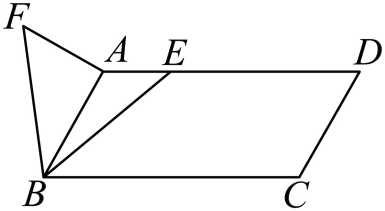

# Mathematics - 题目 232

**ID**: 21cdfc64d1c6403f888c2b76008cb5ef
**年级**: Grade 8
**难度**: Medium
**题型**: Fill-in-the-blank

## 题目
如图，在平行四边形 $ABCD$ 中， $\angle ABC=60{^{\circ }}$ ，点 $E$ 为射线 $AD$ 上的动点，连接 $BE$ ，并将 $BE$ 绕点 $B$ 逆时针旋转 $60{^{\circ }}$ 得到 $BF$ ，连接 $AF$ ，若 $AF$ 的最小值为 $\sqrt {7}$ ，则 $AB=$．​​​​​​​‌

## 解答

1. 解：过 $\mathrm{A}$ 点作 $AH\bot BC$ 于 $H$ 点，在 $BC$ 上截取 $BG=BA$ ，连接 $EG$ ，如图，
2. 
3. $\because BE$ 绕点 $B$ 逆时针旋转 $60{^{\circ }}$ 得到 $BF$ ，
4. $\therefore BF=BE$ ， $\angle EBF=60{^{\circ }}$ ，
5. $\because \angle ABC=60{^{\circ }}$ ，
6. $\therefore \angle EBF-\angle ABE=\angle ABC-\angle ABE$ ，
7. 即 $\angle ABF=\angle GBE$ ，
8. 在 $\mathrm{△}BAF$ 和 $△BGE$ 中，
9. $\begin{cases}BF=BE\\\angle ABF=\angle GBE\\BA=BG\end{cases}$ ，
10. $\therefore \vartriangle BAF\cong $  $\vartriangle BGE\left ({SAS}\right )$ ，
11. $\therefore AF=EG$ ，
12. $\because GE\bot AD$ 时， $EG$ 最小，此时 $AF$ 最小，
13. 而 $AF$ 的最小值为 $\sqrt {7}$ ，
14. $\therefore G$ 点到 $AD$ 的距离为 $\sqrt {7}$ ，
15. $\because $ 四边形 $ABCD$ 为平行四边形，
16. $\therefore AD//BC$ ，
17. $\therefore AH=\sqrt {7}$ ，
18. 在 ${\rm{R}}{\rm{t}}\mathrm{△}ABH$ 中， $\because \angle ABH=60{}\degree $ ，
19. $\therefore BH=\frac {\sqrt {3}}{3}AH=\frac {\sqrt {3}}{3}\times \sqrt {7}=\frac {\sqrt {21}}{3}$ ，
20. $\therefore AB=2BH=\frac {2\sqrt {21}}{3}$ ．

## 知识点

**中文**:
  - 含30度角的直角三角形
  - 平行四边形的对边平行且相等
  - 旋转的性质

**English**:
  - Right Triangle with 30° Angle
  - Opposite Sides Parallel and Equal
  - Properties of Rotation

---
