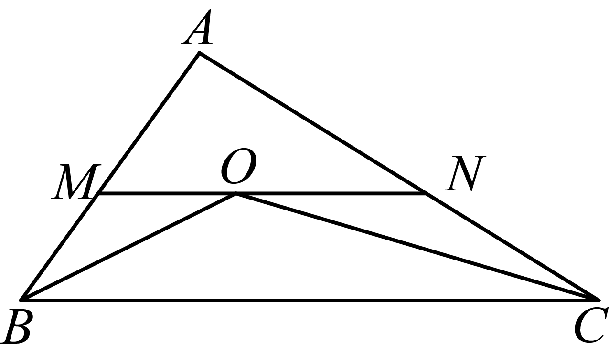

# Mathematics - 题目 457

**ID**: 36e8f16be7354fbe9e0d52ea55d35b72
**年级**: Grade 8
**难度**: Medium
**题型**: Fill-in-the-blank

## 题目
如图，在 $\vartriangle ABC$ 中， $AB=6$ ， $AC=8$ ， $\angle ABC$ 和 $\angle ACB$ 的平分线交于 $O$ 点，过点 $O$ 作 $BC$ 的平行线交 $AB$ 于 $M$ 点，交 $AC$ 于 $N$ 点，则 $\vartriangle AMN$ 的周长为．​​​​​​​‌

## 解答

1. 解： $\because BO$ 平分 $\angle ABC$ ， $CO$ 平分 $\angle ACB$ ，
2. $\therefore \angle ABO=\angle OBC$ ， $\angle ACO=\angle OCB$ ，
3. $\because MN\parallel BC$ ，
4. $\therefore \angle MOB=\angle OBC$ ， $\angle NOC=\angle OCB$ ，
5. $\therefore \angle ABO=\angle MOB$ ， $\angle ACO=\angle NOC$ ，
6. $\therefore MB=MO$ ， $NO=NC$ ，
7. $\because $  $AB=6$ ， $AC=8$ ，
8. $\therefore \vartriangle AMN$ 的周长 $=AM+MN+AN$
9. $=AM+MO+ON+AN$
10. $=AM+MB+NC+AN$
11. $=AB+AC$
12. $=6+8$
13. $=14$ .

## 知识点

**中文**:
  - 等腰三角形的判定与性质

**English**:
  - Determination and Properties

---
